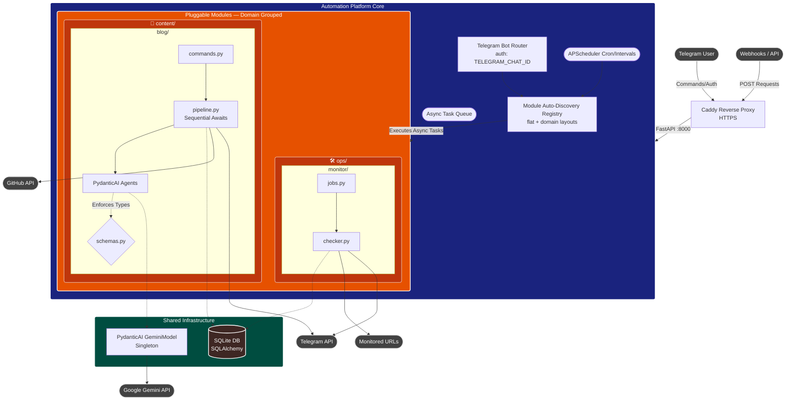

# Automation Server Architecture

The `automation/` platform running at `ai.yourdomain.com` utilizes a pluggable, asynchronous, and memory-efficient architecture. By using PydanticAI instead of heavier frameworks, the entire platform runs smoothly on a 1GB RAM VM.

Modules are organized into **domains** (`content/`, `ops/`). Each domain is a namespace folder containing focused submodules. Both domain-grouped and legacy flat layouts are supported simultaneously by the registry.

Below is the high-level architecture diagram detailing how requests flow from external interfaces down to individual modules and the shared infrastructure.

## Layers Explained

1. **Gateway**: `Caddy` handles SSL and routes all traffic into the `FastAPI` instance.
2. **Core Platform**:
   - Receives Telegram commands and parses webhooks.
   - The `Registry` scans `modules/` with a two-level discovery strategy:
     - **Flat module** (`modules/<name>/`): its `__init__.py` has `register()` directly. Loaded as-is, no domain label.
     - **Domain namespace** (`modules/<domain>/`): its `__init__.py` has *no* `register()`. The registry scans one level deeper and loads each submodule, attaching the domain name for grouping in `/help` and `/start`.
3. **Shared Infrastructure**:
   - `SQLAlchemy` provides persistent storage via a single `SQLite` file on a persistent volume. All module models inherit from the shared `core.db.Base`.
   - The **LLM tier registry** (`core/llm.py`) maintains two lazily-created model singletons:
     - **`primary`** — high-quality model for the blog pipeline (research, writing, editing). Configured via `LLM_MODEL`.
     - **`nano`** — fast/cheap model for the chat assistant and ideas generation. Configured via `LLM_NANO_MODEL`. Falls back to `primary` if not set.
     - Agents call `get_model("primary")` or `get_model("nano")` — switching providers or models is a `.env` change only.
4. **Modules**:
   - Fully isolated logic. Each submodule (e.g. `content/blog`) interacts with `PydanticAI` and its own schemas locally.
   - Adding a new domain or submodule requires zero changes to core — the registry discovers it automatically on the next restart.
