# Automation Server Architecture

The `automation/` platform running at `ai.yourdomain.com` utilizes a pluggable, asynchronous, and memory-efficient architecture. By using PydanticAI instead of heavier frameworks, the entire platform runs smoothly on a 1GB RAM VM.

Modules are organized into **domains** (`content/`, `ops/`). Each domain is a namespace folder containing focused submodules. Both domain-grouped and legacy flat layouts are supported simultaneously by the registry.

Below is the high-level architecture diagram detailing how requests flow from external interfaces down to individual modules and the shared infrastructure.

```mermaid
graph TD
    %% Define Styles
    classDef sys fill:#1A237E,color:#fff,stroke:#fff,stroke-width:2px,rx:5px,ry:5px
    classDef ext fill:#424242,color:#fff,stroke:#E0E0E0,stroke-width:1px,rx:5px,ry:5px
    classDef core fill:#004D40,color:#fff,stroke:#fff,stroke-width:2px,rx:5px,ry:5px
    classDef mod fill:#E65100,color:#fff,stroke:#fff,stroke-width:2px,rx:5px,ry:5px
    classDef domain fill:#BF360C,color:#fff,stroke:#fff,stroke-width:1px,rx:5px,ry:5px
    classDef storage fill:#3E2723,color:#fff,stroke:#fff,stroke-width:2px,rx:5px,ry:5px

    %% External Interfaces
    User([Telegram User]) -->|Commands/Auth| Caddy
    Trigger([Webhooks / API]) -->|POST Requests| Caddy
    
    %% Gateway
    Caddy[Caddy Reverse Proxy\nHTTPS] -->|FastAPI :8000| CoreApp

    %% Core Application Layer
    subgraph CoreApp [Automation Platform Core]
        Bot[Telegram Bot Router\nauth: TELEGRAM_CHAT_ID]
        Registry[Module Auto-Discovery Registry\nflat + domain layouts]
        Scheduler([APScheduler Cron/Intervals])
        Queue([Async Task Queue])
        
        Bot --> Registry
        Scheduler --> Registry
        Queue -.->|Executes Async Tasks| DomainModules
    end
    class CoreApp sys

    %% Domain + Module Layer
    Registry --> DomainModules
    subgraph DomainModules [Pluggable Modules — Domain Grouped]

        subgraph ContentDomain [📝 content/]
            direction TB
            subgraph Blog [blog/]
                BlogCmds[commands.py] --> BlogPipeline[pipeline.py\nSequential Awaits]
                BlogPipeline --> Agents[PydanticAI Agents]
                Agents -.->|Enforces Types| Schemas{schemas.py}
            end
        end

        subgraph OpsDomain [🛠 ops/]
            direction TB
            subgraph Monitor [monitor/]
                MonJobs[jobs.py] --> Checker[checker.py]
            end
        end

        subgraph FinanceDomain [💹 finance/]
            direction TB
            subgraph WatchlistSub [watchlist/]
                WCmds[commands.py] --> WPrices[prices.py]
            end
            subgraph TechnicalSub [technical/]
                TCmds[commands.py] --> TInd[indicators.py\nNumPy-native Extrema]
                TCmds --> TCharts[charts.py]
            end
            subgraph FundamentalSub [fundamental/]
                FCmds[commands.py] --> FStrat[strategies/\nGraham value screen]
            end
            subgraph TraderSub [trader/]
                TrScan[scanner.py\nSMC / HTF Bias] --> TrOMS[oms/\nRisk & Paper Broker]
            end
        end

    end
    class DomainModules mod
    class ContentDomain,OpsDomain,FinanceDomain domain

    %% Infrastructure & APIs
    subgraph Context [Shared Infrastructure]
        DB[(SQLite DB\nSQLAlchemy)]
        LLM[PydanticAI Multi-Tier Models\nPrimary / Nano / Fallback]
    end
    class Context core
    class DB storage

    %% Module to DB/LLM connection
    BlogPipeline -.-> DB
    Checker -.-> DB
    WPrices -.-> DB
    TInd -.-> DB
    TrOMS -.-> DB
    Agents -.-> LLM
    
    %% External API connections
    LLM --> Google([Google Gemini API / OpenRouter])
    BlogPipeline --> GH([GitHub API])
    BlogPipeline --> TG([Telegram API])
    Checker --> Target([Monitored URLs])
    Checker --> TG
    WPrices --> YF([yfinance / Free Tier])
    TCharts --> YF
    TrScan --> YF & Binance([Binance Klines])

    class User,Trigger,Google,GH,TG,Target,YF,Binance ext
```

## Layers Explained

1. **Gateway**: `Caddy` handles SSL and routes all traffic into the `FastAPI` instance.
2. **Core Platform**:
   - Receives Telegram commands, parses webhooks, and manages background tasks.
   - **System Status & Versioning (`core/version.py`)**: `/status` and `/version` provide live build metadata (semantic version, short git commit SHA, build date, and change summary).
   - The `Registry` scans `modules/` with a two-level discovery strategy:
     - **Flat module** (`modules/<name>/`): its `__init__.py` has `register()` directly. Loaded as-is, no domain label.
     - **Domain namespace** (`modules/<domain>/`): its `__init__.py` has *no* `register()`. The registry scans one level deeper and loads each submodule, attaching the domain name for grouping in `/help` and `/start`.
3. **Shared Infrastructure**:
   - `SQLAlchemy` provides persistent storage via a single `SQLite` file on a persistent volume. All module models inherit from the shared `core.db.Base`.
   - The **LLM tier registry** (`core/llm.py`) maintains three lazily-created model singletons:
     - **`primary`** — high-quality model for complex tasks (research, writing, editing). Configured via `LLM_MODEL` (default: `gemini-2.0-flash`).
     - **`nano`** — fast/cheap model for intent routing, chat assistant, and fundamental verdicts. Configured via `LLM_NANO_MODEL`. Falls back to `primary` if not set.
     - **`fallback`** — automatically invoked via `run_with_fallback()` on retryable transient errors (503, 429, 524). Configured via `LLM_FALLBACK_MODEL`.
   - **Memory-Safe Helpers (`finance/_shared/`)**:
     - `extrema.py`: 100% vectorized NumPy-native relative extrema detection replacing the heavy `scipy` dependency on 1 GB RAM machines.
     - `chart_renderer.py`: Spawns short-lived subprocesses for matplotlib/mplfinance rendering, releasing 100% of chart memory upon exit.
4. **Modules**:
   - Fully isolated logic across `content/`, `ops/`, and `finance/`. Each submodule interacts with its domain models and schemas locally.
   - Adding a new domain or submodule requires zero changes to core — the registry discovers it automatically on startup.
