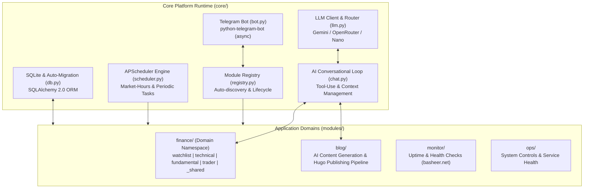
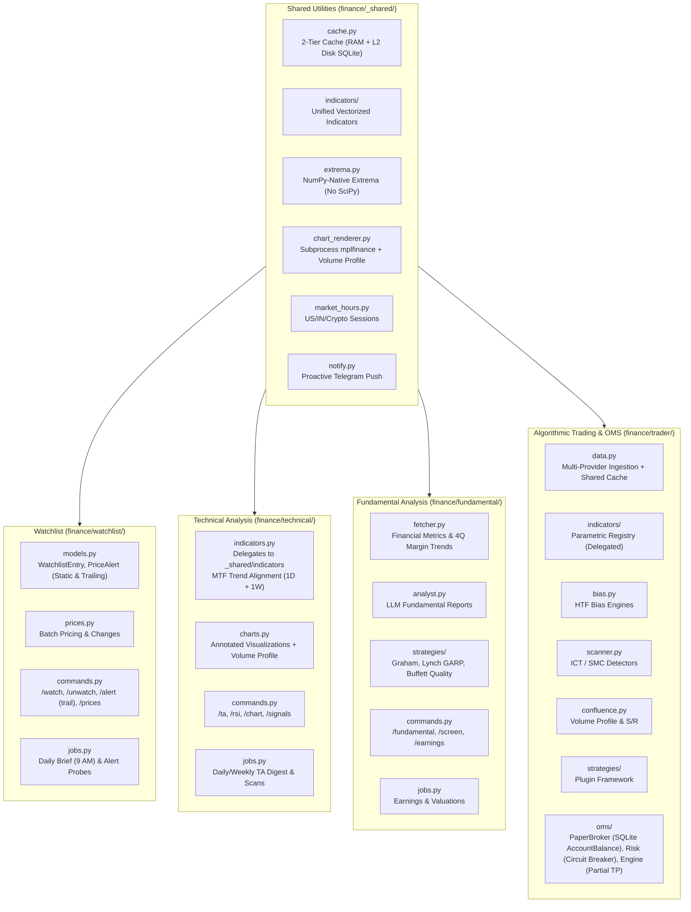

# Basheer.net Automation Engine — Architecture Specification

## 1. System Overview & Core Platform

The automation system (`automation/app/`) is an extensible multi-domain automation platform built in Python 3.13, deployed on GCP via Docker. It integrates an asynchronous Telegram bot, scheduled cron/interval tasks (APScheduler), SQLite persistence (SQLAlchemy 2.0), multi-tier LLM integrations, and modular application domains.

> 📚 **Related Documentation & Sub-Module Guides:**
> - 📖 **Operator & Developer Manual:** [OPERATOR_AND_DEVELOPER_GUIDE.md](OPERATOR_AND_DEVELOPER_GUIDE.md) — Command reference, adding strategies/indicators/brokers.
> - 💹 **Finance Domain Overview:** [modules/finance/README_finance.md](modules/finance/README_finance.md) — Central architecture, shared cache & market hours.
> - 📋 **Watchlist Submodule:** [modules/finance/watchlist/README_finance_watchlist.md](modules/finance/watchlist/README_finance_watchlist.md) — Asset registry, batch pricing & price alerts.
> - 📊 **Technical Analysis Submodule:** [modules/finance/technical/README_finance_technical.md](modules/finance/technical/README_finance_technical.md) — Indicators, divergence detection & charts.
> - 📈 **Fundamental Analysis Submodule:** [modules/finance/fundamental/README_finance_fundamental.md](modules/finance/fundamental/README_finance_fundamental.md) — Graham value screening & AI verdicts.
> - 🎯 **Trading Engine & OMS Deep-Dive:** [modules/finance/trader/README_finance_trader.md](modules/finance/trader/README_finance_trader.md) — Detailed SMC scanner, indicator graph, OMS execution & roadmap.
> - 🌐 **High-Level Platform Overview:** [../README.md](../README.md) & [../ARCHITECTURE.md](../ARCHITECTURE.md) — Gateway, Caddy SSL, platform roadmap.

---

## 2. Core Architecture Components (`core/`)

| Component | Primary File | Responsibility |
|---|---|---|
| **Telegram Gateway** | [`core/bot.py`](core/bot.py) | Application initialization, authentication filtering (`authorized_only`), webhook/polling routing, error handling. |
| **System Versioning** | [`core/version.py`](core/version.py) | Dynamic build metadata tracking (`v1.2.1`, git commit hash, build date, and change summary) for `/status`, `/version`, and API health checks. |
| **Module Registry** | [`core/registry.py`](core/registry.py) | Recursively scans `modules/`, executes module `register()`, collects slash commands, schedules jobs, and builds interactive `/help`. |
| **Database Engine** | [`core/db.py`](core/db.py) | SQLite connection pool with Write-Ahead Logging (`WAL`), `busy_timeout=5000`, `synchronous=NORMAL`, `Base` metadata, auto-migration engine, and cross-environment path resolution. |
| **LLM Gateway** | [`core/llm.py`](core/llm.py) | Multi-provider orchestration (Gemini, OpenRouter, OpenAI-compatible), automatic fallback tier on 503/429/524, and nano-tier delegation. |
| **Scheduler** | [`core/scheduler.py`](core/scheduler.py) | APScheduler background daemon managing recurring jobs. |
| **AI Assistant** | [`core/chat.py`](core/chat.py) | Conversational context buffer, tool declaration, dynamic tool dispatching. |

---

## 3. Finance Domain (`modules/finance/`)

The `finance/` folder is a **Domain Namespace Package**. It contains 4 business sub-modules and 1 shared utilities library.

### 3.1. `finance/watchlist/` — Asset Registry & Price Engine
- **Documentation**: Dedicated guide in [modules/finance/watchlist/README_finance_watchlist.md](modules/finance/watchlist/README_finance_watchlist.md) and overview in [modules/finance/README_finance.md#2-watchlist-module](modules/finance/README_finance.md#2-watchlist-module)
- **Purpose**: Tracks symbols across categories (`us_stock`, `india_stock`, `crypto`, `forex`, `commodity`, `index`), manages static threshold and trailing percentage price alerts (`/alert <symbol> trail -5%`), and dispatches the daily morning briefing.
- **Data Model**: `WatchlistEntry` (`id`, `symbol`, `category`, `added_at`, `notes`), `PriceAlert` (`alert_type`, `target_price`, `trail_pct`, `peak_price`).
- **Engine**: [`prices.py`](modules/finance/watchlist/prices.py) provides parallel batch fetching via yfinance, 24h delta computations, and formatted summaries.

### 3.2. `finance/technical/` — Classical Indicator & Charting Suite
- **Documentation**: Dedicated guide in [modules/finance/technical/README_finance_technical.md](modules/finance/technical/README_finance_technical.md) and overview in [modules/finance/README_finance.md#3-technical-analysis-module](modules/finance/README_finance.md#3-technical-analysis-module)
- **Purpose**: Classical indicators, multi-timeframe candlestick calculations, multi-extrema RSI divergence detection with swing validation, prospective setup monitoring, Multi-Timeframe (MTF) 1D + 1W trend alignment, and visual snapshot charts with Volume Profile overlays.
- **Engine**: Computes RSI(14) with boundary-crossing triggers, EMA 21/50/100/200, crossover alerts, and potential curling setups via unified `_shared/indicators/`; evaluates 1D vs. 1W EMA alignment; leverages 100% NumPy-native extrema (`extrema.py`) and renders memory-isolated charts via `mplfinance` subprocesses.

### 3.3. `finance/fundamental/` — Valuation & Balance Sheet Analysis
- **Documentation**: Dedicated guide in [modules/finance/fundamental/README_finance_fundamental.md](modules/finance/fundamental/README_finance_fundamental.md) and overview in [modules/finance/README_finance.md#4-fundamental-analysis-module](modules/finance/README_finance.md#4-fundamental-analysis-module)
- **Purpose**: Fundamental metrics ingestion, trailing 4-quarter margin compression detection, peer valuation, multi-strategy value screening (Graham, Lynch GARP, Buffett Quality), and automated LLM-driven financial analysis.
- **Engine**: Fetches P/E, PEG, EV/EBITDA, Debt/Equity, Free Cash Flow, Profit Margins; flags consecutive quarterly margin compression; generates structured investment notes.

### 3.4. `finance/trader/` — Institutional SMC Scanner & OMS
- **Documentation**: Dedicated deep-dive & roadmap in [modules/finance/trader/README_finance_trader.md](modules/finance/trader/README_finance_trader.md)
- **Purpose**: Institutional Smart Money Concepts (BOS, CHoCH, Order Blocks, FVGs, Liquidity Sweeps, Fixed-Range Volume Profile) coupled with an automated Order Management System (OMS).
- **Sub-architecture**:
  - `data.py`: Category data routing (`BinanceProvider` for 4H/1H crypto, `YFinanceProvider` for equities) with shared cross-submodule OHLCV caching.
  - `indicators/`: Parametric indicator engine delegating to `_shared/indicators/`.
  - `bias.py`: Higher Timeframe directional regime & hidden divergence detectors.
  - `strategies/`: Auto-discovered strategy plugins inheriting from `BaseStrategy`.
  - `oms/`: Order execution, paper broker persisting settled cash in SQLite `account_balances` table, dynamic risk sizing with Portfolio Circuit Breaker (Kill Switch on >3% 24h drawdown / 3 stops, `/resume` manual override), and Partial TP1 (50% scale-out with breakeven stop adjustment).

---

## 4. Blog, Monitoring & Operational Modules

### 4.1. Blog Module (`modules/blog/`)
- **Purpose**: Automated content writing, SEO optimization, and Git-based publishing to the Hugo static site (`basheer.net`).
- **Pipeline**:
  1. `agents.py`: Multi-stage LLM workflow (Researcher $\rightarrow$ Outliner $\rightarrow$ Writer $\rightarrow$ Editor $\rightarrow$ SEO optimizer).
  2. `pipeline.py`: Asynchronous task execution and Hugo frontmatter rendering.
  3. `tools.py`: GitHub API integration committing `.md` files directly to `bash07/basheer.net`.

### 4.2. Monitor Module (`modules/monitor/`)
- **Purpose**: Synthetic uptime monitoring and endpoint health verification for `basheer.net` and infrastructure services.
- **Engine**: `checker.py` runs HTTP/TLS probe cycles every 5 minutes; notifies Telegram upon consecutive failures with response codes and latency stats.

### 4.3. Ops Module (`modules/ops/`)
- **Purpose**: Administrative controls, container inspection, resource metrics (CPU, RAM, Disk), and log tailing.
- **Security**: Bound to authorized administrative Telegram chat IDs.

---

## 5. Security, Deployment & Environment

- **Containerization**: Runs in Docker (`agent-server`).
- **Storage**: Persistent volume mounted at `/app/data/` (`automation_data`).
- **Secrets Management**: Environment variables loaded via `.env`:
  - Telegram: `TELEGRAM_BOT_TOKEN`, `TELEGRAM_CHAT_ID`
  - LLM: `GEMINI_API_KEY`, `OPENROUTER_API_KEY`
  - GitHub: `GITHUB_TOKEN`, `GITHUB_REPO`
- **Graceful Failure**: All external API calls (yfinance, Binance, Gemini, GitHub) run in thread executors with fallbacks, timeouts, and Telegram error formatting.
