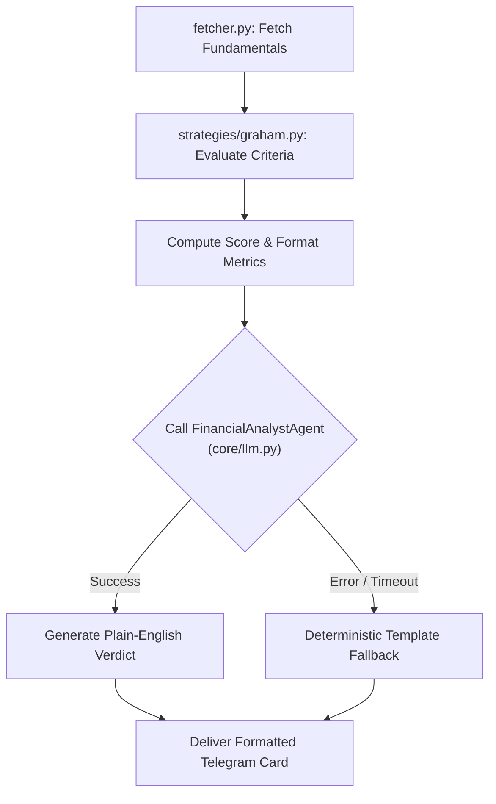

# Fundamental Analysis Submodule (`finance/fundamental/`)

> 📚 **Navigation:**
> - [Finance Domain Root](../README_finance.md)
> - [Watchlist Submodule](../watchlist/README_finance_watchlist.md)
> - [Technical Analysis Submodule](../technical/README_finance_technical.md)
> - [Algorithmic Trader & OMS](../trader/README_finance_trader.md)
> - [System Architecture](../../SYSTEM_ARCHITECTURE.md)

---

## 1. Overview & Purpose

The **Fundamental Analysis Submodule** (`modules/finance/fundamental/`) provides automated valuation screening, financial statement evaluation, and AI-driven equity research reports directly through Telegram.

### Core Capabilities:
- **Comprehensive Financial Ingestion**: Pulls balance sheets, income statements, cash flows, and valuation multiples via `yfinance`.
- **Algorithmic Strategy Plugins**: Evaluates equities against quantitative investment frameworks (default: **Benjamin Graham Value Method**).
- **LLM Synthesis & Executive Verdicts**: Employs PydanticAI and Gemini to synthesize complex financial ratios into clear 3–4 sentence executive summaries.
- **Resilient Fallback Engine**: Instantly generates deterministic report cards if the LLM provider experiences timeouts or rate limits.
- **Cross-Watchlist Stock Screener**: Ranks all watchlisted equities against chosen investment criteria.
- **Proactive Earnings Calendar**: Alerts the operator 3 days before any tracked company reports earnings.

---

## 2. Submodule Architecture & File Structure

```
automation/app/modules/finance/fundamental/
├── __init__.py           # Submodule registration & APScheduler job binding
├── fetcher.py            # Financial statement extraction, FundamentalsData model, 4Q margin trends
├── analyst.py            # LLM FinancialAnalystAgent & template fallback generator
├── formatter.py          # Telegram HTML card formatting, margin warnings & tables
├── commands.py           # Slash command handlers (/fundamental, /screen, /earnings)
├── jobs.py               # Scheduled jobs (weekly value screen & earnings alerts)
└── strategies/           # Pluggable valuation strategy package
    ├── __init__.py       # Strategy registry (graham, lynch, buffett) & get_strategy()
    ├── base.py           # Abstract BaseStrategy, CriterionResult, StrategyResult
    ├── graham.py         # Benjamin Graham 6-factor value strategy implementation
    ├── lynch.py          # Peter Lynch GARP (Growth at a Reasonable Price) strategy
    └── buffett.py        # Warren Buffett Quality & Moat strategy
```

### Component Breakdown

| Component | Responsibility |
| :--- | :--- |
| `fetcher.py` | Fetches corporate metrics from `Ticker.info` and calculates 4-quarter operating/gross margin compression. |
| `strategies/` | Evaluates strategies: `graham` (Graham 6-factor), `lynch` (PEG & growth), `buffett` (ROE & margin quality). |
| `analyst.py` | Dispatches prompts to `FinancialAnalystAgent` via `core.llm.get_model()`. |
| `formatter.py` | Formats criteria tables, score indicators (`✅`, `❌`, `⚪`), margin alerts, and earnings dates. |
| `jobs.py` | Runs the Sunday 08:00 AM IST watchlist screen and daily earnings checks. |
| `commands.py` | Exposes `/fundamental`, `/screen`, and `/earnings` commands (supporting `graham`, `lynch`, `buffett`). |

---

## 3. Benjamin Graham Value Screening Methodology

The default strategy implements the classical value investing checklist established by **Benjamin Graham**:

| # | Criterion | Mathematical Rule | Economic Rationale |
| :---: | :--- | :--- | :--- |
| 1 | **P/E Ratio** | $\text{Trailing P/E} < 15.0$ | Ensures reasonable valuation relative to recent earning power. |
| 2 | **P/B Ratio** | $\text{Price-to-Book} < 1.50$ *(or $\text{P/E} \times \text{P/B} < 22.5$)* | Protects against paying excess premiums over tangible assets. |
| 3 | **Current Ratio** | $\frac{\text{Current Assets}}{\text{Current Liabilities}} > 2.0$ | Verifies sufficient working capital buffer for short-term obligations. |
| 4 | **Debt-to-Equity** | $\frac{\text{Total Debt}}{\text{Total Equity}} < 0.50$ | Guards against excessive financial leverage and insolvency risk. |
| 5 | **Dividend Yield** | $\text{Dividend Yield} > 0.0\%$ | Favors companies returning capital to shareholders with stable cash flows. |
| 6 | **5-Year EPS Growth** | $5\text{Y EPS CAGR} > 0.0\%$ | Confirms a long-term track record of compounding earnings. |

### Scoring & Verdict Classification:
- **Strong Value** ($\ge 5 / 6$): Meets institutional margin of safety standards.
- **Moderate Value** ($3–4 / 6$): Meets key solvency criteria but may trade at a premium.
- **Fails Value Screen** ($< 3 / 6$): Insufficient margin of safety or high balance sheet risk.

---

### 3.2 Peter Lynch GARP Strategy (`lynch`)
Screens for growth companies trading at a reasonable valuation using Peter Lynch's methodology:
1. **PEG Ratio**: $\text{Trailing P/E} / (\text{EPS Growth} \times 100) \le 1.0$ (fair value / undervalued relative to earnings growth).
2. **EPS Growth**: $\text{TTM EPS Growth} > 5.0\%$ (sustainable positive earnings momentum).
3. **Debt-to-Equity**: $\text{Debt/Equity} < 0.80$ (prudent balance sheet leverage).
4. **Current Ratio**: $\text{Current Ratio} > 1.20$ (adequate liquidity).
5. **P/E Ratio**: $\text{Trailing P/E} < 35.0$ (avoids speculative valuation multiples).

---

### 3.3 Warren Buffett Quality & Moat Strategy (`buffett`)
Evaluates economic moat durability, pricing power, and return on capital:
1. **Return on Equity (ROE)**: $\text{ROE} \ge 15.0\%$ (exceptional compound return on shareholder equity).
2. **Profit Margin**: $\text{Net Profit Margin} \ge 12.0\%$ (strong pricing power and high operating margins).
3. **Debt-to-Equity**: $\text{Debt/Equity} \le 0.60$ (conservative financial structure).
4. **Current Ratio**: $\text{Current Ratio} \ge 1.50$ (bulletproof working capital).
5. **EPS Growth**: $\text{EPS Growth} > 5.0\%$ (demonstrated earnings compounding).
6. **Valuation**: $\text{Trailing P/E} < 25.0$ (avoids overpaying for quality).

---

### 3.4 Trailing 4-Quarter Margin Compression Engine
- Automatically extracts quarterly income statements across the trailing 4 reported quarters via `yfinance`.
- Tracks quarterly **operating margin** and **gross margin** trajectory.
- **Alert Flag**: If operating margins decline across 3 consecutive quarters, generates an explicit `margin_trend_warning` formatted as `⚠️ Margin Alert: Margin Compression Alert: Operating margin has declined for 3 consecutive quarters...` within the `/fundamental` report to warn of operational cost inflation prior to earnings.

---

## 4. LLM Synthesis & Fallback Architecture

When a fundamental analysis is requested, `analyst.py` initiates a two-tier evaluation pipeline:



### The Analyst Prompt:
The LLM is prompted with structured, pre-calculated quantitative data (pass/fail status, actual ratios, and sector classification) and instructed to produce:
1. Executive summary of the score.
2. The company's primary balance sheet strength.
3. The most critical fundamental risk or valuation concern.
4. An objective, non-advisory analytical takeaway.

---

## 5. Telegram Slash Command Reference

### 5.1 `/fundamental`
Executes an in-depth fundamental analysis and returns a formatted card with the strategy scorecard and LLM verdict.
- **Syntax**: `/fundamental <ticker> [--method <graham>]`
- **Default Method**: `graham`
- **Example**: `/fundamental AAPL`
- **Output Sample**:
  ```
  🏛️ Apple Inc. (AAPL) — Graham Value Screen
  Score: 3/6 Criteria Passed (Moderate Value)

  • P/E Ratio: 34.2 (Max 15.0) ❌ FAIL
  • P/B Ratio: 48.1 (Max 1.5) ❌ FAIL
  • Current Ratio: 1.07 (Min 2.0) ❌ FAIL
  • Debt/Equity: 1.45 (Max 0.5) ❌ FAIL
  • Dividend Yield: 0.44% (Min 0%) ✅ PASS
  • 5Y EPS Growth: +15.2% (Positive) ✅ PASS

  🤖 Analyst Verdict:
  Apple demonstrates strong 5-year earnings growth and consistent shareholder dividend returns, reflecting exceptional operational resilience. However, trading at an elevated P/E of 34.2 and high Debt-to-Equity ratio, it does not meet Graham's classical margin-of-safety valuation thresholds.
  ```

### 5.2 `/screen`
Screens all tracked equities across the watchlist and ranks them by their compliance score.
- **Syntax**: `/screen [--method <graham>]`
- **Example**: `/screen`

### 5.3 `/earnings`
Scans watchlisted companies for upcoming corporate earnings dates.
- **Syntax**: `/earnings [days]`
- **Default Window**: 7 days
- **Example**: `/earnings 14`

---

## 6. Scheduled Background Jobs

### 6.1 `weekly_screen_job`
- **Schedule**: Every Sunday at 08:00 AM IST (`CronTrigger(day_of_week="sun", hour=8, minute=0)`).
- **Execution**: Evaluates all watchlisted stocks against the Graham method and dispatches a ranked leaderboard to Telegram.

### 6.2 `earnings_alert_job`
- **Schedule**: Every day at 08:00 AM IST (`CronTrigger(hour=8, minute=0)`).
- **Execution**: Checks for earnings release announcements occurring within the next 3 calendar days and sends proactive reminder alerts.

---

## 7. Extending Valuation Frameworks (Developer Guide)

To add a new strategy (e.g. Peter Lynch GARP or Warren Buffett Quality Checklist):

1. **Subclass `BaseStrategy`** in `strategies/`:
   ```python
   # strategies/lynch.py
   from .base import BaseStrategy, CriterionResult, StrategyResult
   from ..fetcher import FundamentalsData

   class LynchStrategy(BaseStrategy):
       name = "lynch"
       description = "Peter Lynch Growth at a Reasonable Price (PEG)"

       def evaluate(self, data: FundamentalsData) -> StrategyResult:
           criteria = []
           # Example: PEG Ratio < 1.0
           peg = data.pe_ratio / data.eps_growth_5y if data.eps_growth_5y else None
           passed = (peg is not None) and (peg < 1.0)
           criteria.append(CriterionResult(
               name="PEG Ratio",
               passed=passed,
               actual=f"{peg:.2f}" if peg else "N/A",
               threshold="< 1.0"
           ))
           return StrategyResult(
               method=self.name,
               symbol=data.symbol,
               criteria=criteria,
               score=sum(1 for c in criteria if c.passed is True),
               total=len(criteria),
               max_score=len(criteria)
           )
   ```
2. **Register the Strategy** in `strategies/__init__.py`:
   ```python
   from .lynch import LynchStrategy

   STRATEGIES = {
       "graham": GrahamStrategy(),
       "lynch": LynchStrategy(),
   }
   ```
3. The strategy is instantly selectable via `/fundamental MSFT --method lynch` or `/screen --method lynch`.
