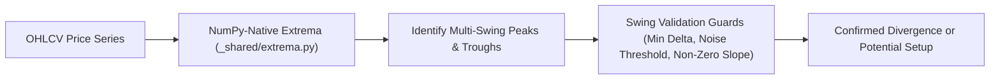

# Technical Analysis Submodule (`finance/technical/`)

> 📚 **Navigation:**
> - [Finance Domain Root](../README_finance.md)
> - [Watchlist Submodule](../watchlist/README_finance_watchlist.md)
> - [Fundamental Analysis Submodule](../fundamental/README_finance_fundamental.md)
> - [Algorithmic Trader & OMS](../trader/README_finance_trader.md)
> - [System Architecture](../../SYSTEM_ARCHITECTURE.md)

---

## 1. Overview & Purpose

The **Technical Analysis Submodule** (`modules/finance/technical/`) provides on-demand charting, quantitative indicator calculation, multi-extrema divergence detection, and proactive signal alerting across all watchlisted tickers.

### Core Capabilities:
- **Full-Spectrum Classical TA**: Computes RSI, EMAs (21/50/100/200), SMAs (20/50/200), MACD, Bollinger Bands, and Volume Spikes.
- **Advanced RSI Divergence Engine**: Detects regular and hidden divergences across multiple price and RSI swing extrema with strict swing validation guards.
- **NumPy-Native Peak Detection**: Pure NumPy peak and trough detection via `modules/finance/_shared/extrema.py`, eliminating heavy third-party dependencies (SciPy) while maintaining sub-millisecond execution.
- **Stateful Signal Alerts**: Prevents repetitive Telegram notifications through boundary-crossing transition tracking (`oversold_in`, `overbought_in`, `exit`).
- **Potential Setup Warnings**: Flags prospective/forming setups (e.g., RSI curling towards oversold boundaries) before confirmation.
- **Isolated Subprocess Charting**: Generates candlestick charts via `mplfinance` inside dedicated subprocesses, preventing memory fragmentation in long-running bot processes.

---

## 2. Submodule Architecture & File Structure

```
automation/app/modules/finance/technical/
├── __init__.py      # Submodule registration & APScheduler job binding
├── indicators.py    # Classical indicator algorithms, divergence engine, TAResult
├── charts.py        # Subprocess chart generation bridge using mplfinance
├── models.py        # SQLAlchemy schema for signal logging (SignalLog)
├── commands.py      # Telegram slash command handlers (/ta, /rsi, /chart, /signals)
└── jobs.py          # Proactive signal scanner job (30-min market-aware intervals)
```

### Component Breakdown

| File | Primary Responsibility |
| :--- | :--- |
| `indicators.py` | Contains `compute_ta()` and all mathematical indicator logic; outputs `TAResult`. |
| `charts.py` | Interfaces with `modules/finance/_shared/chart_renderer.py` to create annotated `.png` charts. |
| `models.py` | Defines `SignalLog` table for storing historical signals and tracking notification deduplication. |
| `jobs.py` | Executes `scan_signals_job` on active markets and sends proactive alerts to Telegram. |
| `commands.py` | Handles user interactions (`/ta`, `/rsi`, `/chart`, `/signals`). |

---

## 3. Indicator Specifications & Mathematical Rules

### 3.1 Relative Strength Index (RSI 14)
- **Period**: 14 candles using Wilder's exponential smoothing.
- **Overbought / Oversold Bands**: Fixed thresholds at `70.0` and `30.0`.
- **Boundary-Crossing Triggers**:
  - `oversold_in`: RSI crosses below 30 from above.
  - `overbought_in`: RSI crosses above 70 from below.
  - `exit`: RSI crosses back inside the neutral zone (30–70).

### 3.2 RSI Multi-Extrema Divergence Detection
The divergence engine identifies discrepancies between price movement and momentum across historical swing points.



#### Divergence Classifications:
1. **Regular Bullish Divergence**:
   - Price forms a Lower Low ($P_2 < P_1$).
   - RSI forms a Higher Low ($RSI_2 > RSI_1$).
   - *Indication*: Weakening downward momentum; high-probability reversal.
2. **Regular Bearish Divergence**:
   - Price forms a Higher High ($P_2 > P_1$).
   - RSI forms a Lower High ($RSI_2 < RSI_1$).
   - *Indication*: Exhaustion of upward momentum; potential topping.
3. **Hidden Bullish Divergence**:
   - Price forms a Higher Low ($P_2 > P_1$).
   - RSI forms a Lower Low ($RSI_2 < RSI_1$).
   - *Indication*: Trend continuation in an existing bullish trend.
4. **Hidden Bearish Divergence**:
   - Price forms a Lower High ($P_2 < P_1$).
   - RSI forms a Higher High ($RSI_2 > RSI_1$).
   - *Indication*: Trend continuation in an existing bearish trend.

#### Swing Validation Guards:
To prevent false positives (such as flat-top consolidations or micro-noise in instruments like Gold `GC=F`):
- **Minimum Swing Amplitude**: Extrema must have a prominence of at least 1.5% in price and 3.0 points in RSI.
- **Slope Verification**: Divergence lines must exhibit clear directional divergence; horizontal or near-flat slopes are rejected.
- **Recent Pivot Anchor**: The latest swing pivot must be within the last 5 completed candles to ensure timeliness.

### 3.3 Moving Averages & Trend Stacks
- **Exponential Moving Averages (EMAs)**: 21, 50, 100, 200 periods.
- **Simple Moving Averages (SMAs)**: 20, 50, 200 periods.
- **Trend Determination**:
  - `bullish_stack`: Price > EMA 21 > EMA 50 > EMA 200.
  - `bearish_stack`: Price < EMA 21 < EMA 50 < EMA 200.
  - `mixed`: Interleaved or compressing moving averages.
- **Crossover Signals**:
  - Golden Cross: 50 EMA crosses above 200 EMA.
  - Death Cross: 50 EMA crosses below 200 EMA.
  - Short-Term Momentum: 21 EMA crosses 50 EMA.

### 3.4 Volume Spikes & Bollinger Bands
- **Volume Spike**: Current volume $\ge 2.0 \times$ 20-period simple moving average of volume.
- **Bollinger Bands**: 20-period SMA $\pm 2.0$ standard deviations; tracks band squeezes and touches.

### 3.5 Multi-Timeframe (MTF) Trend Alignment
- **Concept**: Cross-evaluates the Daily (1D) momentum trend against the Weekly (1W) EMA trend stack (21 vs. 50 EMA).
- **Auto-Resampling**: Automatically aggregates daily candles into Friday-close weekly candles when explicit weekly data is omitted.
- **Alignment Signals**:
  - `Aligned Bullish`: 1D bullish + 1W bullish.
  - `Aligned Bearish`: 1D bearish + 1W bearish.
  - `⚠️ MTF Conflict`: Daily trend conflicts with the higher-timeframe weekly regime (e.g. Daily Bullish rally into a Weekly Bearish downtrend), tagging setups with caution warnings.

---

## 4. Subprocess Chart Rendering & Volume Profile Overlay

To prevent memory bloat from Matplotlib and `mplfinance` inside the long-running async bot process, chart rendering runs in a separate process:

1. `technical/charts.py` serializes the OHLCV dataframe, indicator overlays, and Volume Profile levels.
2. It invokes `modules/finance/_shared/chart_renderer.py` via Python `subprocess.run()`.
3. The isolated renderer configures a dark theme canvas:
   - **Panel 0 (Top)**: Candlestick price action with EMA 21, EMA 50, and EMA 200 overlays, plus **Volume Profile levels**:
     - **POC (Point of Control)**: Golden dashed line (`#f1c40f`).
     - **VAH / VAL (Value Area)**: Blue dashed lines (`#3498db`) with a translucent 70% volume area span.
   - **Panel 1 (Middle)**: Volume bars with 20-period volume MA line.
   - **Panel 2 (Bottom)**: RSI 14 line with 70/30 reference threshold levels.
4. The chart is rendered directly to an in-memory PNG buffer and sent to Telegram via `bot.send_photo()`.

---

## 5. Database Schema (`SignalLog`)

Persistent record of detected signals used for alert deduplication and morning briefings.

| Column | Type | Description |
| :--- | :--- | :--- |
| `id` | `INTEGER` | Primary Key, Auto-increment. |
| `symbol` | `VARCHAR(30)` | Ticker symbol (indexed). |
| `signal_type` | `VARCHAR(30)` | Signal classification (`ema_crossover`, `rsi_extreme`, `volume_spike`, `rsi_divergence`). |
| `description` | `TEXT` | Human-readable signal detail (e.g. `Bullish Regular Divergence (1d)`). |
| `detected_at` | `DATETIME` | UTC timestamp of signal detection. |
| `notified` | `BOOLEAN` | Whether an alert has been dispatched to Telegram. |

---

## 6. Telegram Slash Command Reference

### 6.1 `/ta`
Runs a full technical evaluation and replies with an annotated chart image and structured indicator summary.
- **Syntax**: `/ta <ticker> [--tf <1d|1wk|1mo>]`
- **Default Timeframe**: `1d` (Daily).
- **Example**:
  ```
  /ta ^NSEI
  /ta AAPL --tf 1wk
  ```

### 6.2 `/rsi`
Instant textual RSI check without image rendering overhead.
- **Syntax**: `/rsi <ticker>`
- **Example**: `/rsi BTC-USD`
- **Output Sample**:
  ```
  📊 BTC-USD — RSI(14): 28.4 (Oversold 🟢)
  Direction: Curling upward | Potential Bullish Divergence Forming
  ```

### 6.3 `/chart`
Renders and delivers only the candlestick chart image with moving average and RSI panels.
- **Syntax**: `/chart <ticker> [--tf <1d|1wk|1mo>]`
- **Example**: `/chart GC=F`

### 6.4 `/signals`
Displays the latest detected technical signals across all watchlisted tickers from the persistent `SignalLog`.
- **Syntax**: `/signals`

---

## 7. Proactive Signal Scanner (`scan_signals_job`)

- **Schedule**: Every 30 minutes (`IntervalTrigger(minutes=30)`).
- **Market Hours Filtering**: Uses `modules/finance/_shared/market_hours.py` (`is_market_open()`). Skips scanning tickers whose exchanges are currently closed.
- **Deduplication Window**: Suppresses identical alerts for the same symbol and signal type if previously alerted within a 6-hour window.
- **Flood Control**: Implements a 0.5-second pacing delay between Telegram notifications to prevent rate-limit throttling.
