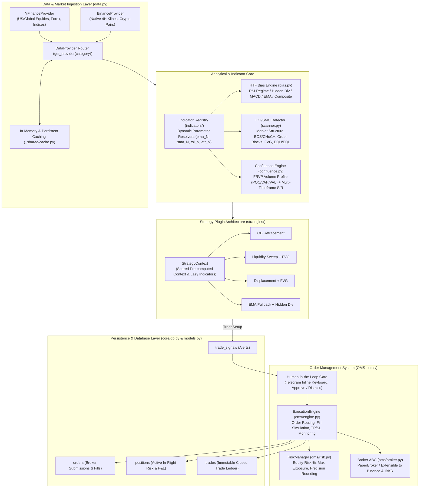

# Finance & Trading Module — Architecture, Technical Specification & Expansion Guide

> 📚 **System Documentation Index:**
> - 🏛️ **System Architecture:** [../../../SYSTEM_ARCHITECTURE.md](../../../SYSTEM_ARCHITECTURE.md) — Multi-module system architecture specification.
> - 📖 **Developer & Operator Manual:** [../../../OPERATOR_AND_DEVELOPER_GUIDE.md](../../../OPERATOR_AND_DEVELOPER_GUIDE.md) — Command reference & developer guide.
> - 💹 **Finance Domain Root:** [../README_finance.md](../README_finance.md) — Central finance architecture.
> - 📋 **Watchlist Submodule:** [../watchlist/README_finance_watchlist.md](../watchlist/README_finance_watchlist.md) — Asset registry & price alerts.
> - 📊 **Technical Analysis Submodule:** [../technical/README_finance_technical.md](../technical/README_finance_technical.md) — Indicator suite & chart engine.
> - 📈 **Fundamental Analysis Submodule:** [../fundamental/README_finance_fundamental.md](../fundamental/README_finance_fundamental.md) — Value screens & AI verdicts.
> - 🌐 **Platform Root:** [../../../../README.md](../../../../README.md) & [../../../../ARCHITECTURE.md](../../../../ARCHITECTURE.md)

## 1. Executive Summary & Vision

The `modules/finance` platform is a production-grade algorithmic trading, portfolio tracking, and automated market intelligence suite built directly into the Telegram bot system. 

It implements an institutional **ICT (Inner Circle Trader) / SMC (Smart Money Concepts) & Quantitative Multi-Factor** trading engine coupled with:
- **Strategy Plugin System (Phase 1)**: Self-contained strategies discovered dynamically via reflection.
- **Provider-Agnostic Data Layer (Phase 2)**: Unified data abstraction dynamically routed across asset categories (yfinance for traditional equities, Binance API for native 4H crypto candles).
- **Extensible Indicator & Multi-Bias Engine (Phase 4)**: Dynamic, parametric indicator computation with dependency resolution and customizable HTF bias algorithms (RSI, MACD, EMA, Composite).
- **Order Management System (OMS) & Paper Trading (Phase 3)**: A complete execution layer with human-in-the-loop gatekeeping, capital-preservation risk sizing, automated TP/SL triggers, and an immutable trade ledger.

---

## 2. System Architecture



---

## 3. Core Technical Sub-Packages

### 3.1. Strategies Sub-package (`modules/finance/trader/strategies/`)
Every strategy inherits from `BaseStrategy`. New strategies added as `.py` files in this directory are auto-discovered without modifying any core orchestrator files.

```python
from modules.finance.trader.strategies.base import BaseStrategy, StrategyContext
from modules.finance.trader.schemas import TradeSetup

class MyNewStrategy(BaseStrategy):
    name = "Breakout + Volume Confirmation"
    description = "Enters on high-volume structure break"
    setup_type = "continuation" # or "reversal"
    priority = 25
    supported_styles = ["swing", "intraday", "scalping"]
    required_indicators = ["structure", "volume_profile", "atr_14", "rsi_14"]
    bias_provider = "composite" # "rsi" | "macd" | "ema" | "composite" | "none"

    def evaluate(self, ctx: StrategyContext) -> TradeSetup | None:
        # ctx provides typed access across the 3-tier timeframe triad:
        # ctx.df_htf      (Where: Trend & Key Zones)
        # ctx.df_mtf      (When: Market Structure Shift / Hidden Divergence)
        # ctx.df_trigger  (How: Entry Rejection / Precise Trigger)
        ...
```

### 3.2. Multi-Timeframe Matrix by Trading Style (The 3-Tier Triad)

Trading strategies operate across a structured 3-tier hierarchy depending on the active trading style:

| Trading Style | Higher Timeframe (HTF)<br>*(Where: Trend & Key Zones)* | Intermediate Timeframe (MTF)<br>*(When: Market Structure Shift)* | Trigger Timeframe (Entry)<br>*(How: Trigger & Tight SL)* | Average Hold Time |
| :--- | :--- | :--- | :--- | :--- |
| **Swing Trading** | Weekly / Daily (`1wk` / `1d`) | 4-Hour (`4h`) | 1-Hour / 15-Min (`1h` / `15m`) | Days to Weeks |
| **Intraday / Day Trading** | 4-Hour / 1-Hour (`4h` / `1h`) | 15-Minute (`15m`) | 5-Minute / 3-Minute (`5m` / `3m`) | Hours |
| **Scalping** | 1-Hour / 15-Minute (`1h` / `15m`) | 5-Minute (`5m`) | 1-Minute (`1m`) | Seconds to Minutes |

#### The 3-Step Execution Framework

1. **Step 1: The HTF Setup (The "Where")**
   * **Objective**: Identify where institutional liquidity and key reaction levels reside.
   * **Action**: Read `df_htf` to establish market bias (Bull/Bear regime) and mark major S/R levels, Higher-Timeframe Order Blocks, or 0.5–0.618 equilibrium Fibonacci zones.
   * **Rule**: Do not initiate trades unless price interacts with a valid HTF zone.

2. **Step 2: The MTF Confirmation (The "When")**
   * **Objective**: Verify that the minor counter-trend has exhausted and the dominant HTF trend is resuming.
   * **Action**: On `df_mtf`, wait for a **Market Structure Shift (MSS)** / **Change of Character (CHoCH)** with aggressive displacement candles, or a confirmed **Hidden Divergence** continuation pivot.

3. **Step 3: The Entry Trigger (The "How")**
   * **Objective**: Execute with a tight stop loss on the micro structure for high asymmetric Risk-to-Reward (R:R).
   * **Action**: On `df_trigger`, execute at an exact confirmation trigger (e.g., 50% FVG retest, broken level retest, or EMA rejection wick).
   * **Stop Loss (SL)**: Placed strictly beyond the invalidation point of the trigger/MTF swing.
   * **Take Profit (TP)**: Target the opposing major HTF liquidity pool or structural swing high/low.

### 3.3. Indicator Registry (`modules/finance/trader/indicators/`)
- **Lazy Evaluation & Dependency Graph**: Indicators declare upstream dependencies. For instance, `macd` requests `ema_12` and `ema_26`. The engine topologically sorts dependencies and avoids redundant calculations.
- **Parametric Resolvers**: Indicators like `ema_9`, `ema_21`, `sma_200`, `rsi_7`, and `atr_20` do not need separate files. They resolve dynamically through regex resolvers registered in `indicators/__init__.py`.

### 3.4. Market Data Providers (`modules/finance/trader/data.py`)
- Category-based routing isolates asset nuances:
  - `crypto` -> `BinanceProvider`: Uses native 4H and 1H klines with ISO/UTC normalization.
  - `us_stock`, `forex`, default -> `YFinanceProvider`: Employs in-memory cache to stay well clear of rate limits.
- Swap providers globally or per category at runtime:
  ```python
  set_provider(MyCustomProvider(), category="crypto")
  ```

### 3.5. Order Management System (`modules/finance/trader/oms/`)

- **Broker Interface (`oms/broker.py`)**: Clean ABC defining `submit_order()`, `close_position()`, `get_account_info()`, and `get_current_price()`.
- **Paper Broker (`oms/paper_broker.py`)**: Maintains settled cash balance, tracks unrealized/realized P&L, and persists state transactionally in SQLite table `account_balances` within `automation.db` (with automatic migration from legacy `paper_account.json`).
- **Risk Management (`oms/risk.py`)**:
  - Fractional equity sizing ($1.0\%$ default risk per trade).
  - Enforces portfolio exposure caps: max 5 open positions, max 25% account capital in a single trade, max 5% aggregate open risk.
  - **Portfolio Circuit Breaker (Kill Switch)**: Automatically halts execution if 24-hour realized losses exceed 3% of equity or if 3 consecutive trades hit stop-loss. Manual reset via `/resume`.
  - Zero-override safety: prevents forced trade sizing that would blow through account risk caps.
- **Execution Engine (`oms/engine.py`)**:
  - Connects human Telegram decisions to position execution.
  - Evaluates candle Highs/Lows against TP1/SL every 30 minutes in the background loop.
  - **Partial Take-Profit (TP1) & Breakeven SL**: Scales out 50% of position size upon hitting TP1 and shifts `stop_loss` to `entry_price` to lock in a risk-free trade.
  - Conservative ambiguous candle policy: defaults to SL-first if a candle touches both TP and SL.

---

## 4. Database Schema Reference

The database resides in SQLite (`automation.db`) under `/app/data/` (or local fallback).

```
trade_signals
 ├── id (PK)
 ├── ticker, category, mode
 ├── setup_name, direction, setup_type, bias
 ├── conf_score, conf_label
 ├── entry_mid, stop_loss, tp1, rr_ratio
 ├── human_approved (NULL=pending, True=approved, False=dismissed)
 └── outcome, outcome_date, realised_rr (tracks raw algorithmic win-rate)

positions
 ├── id (PK)
 ├── signal_id (FK -> trade_signals.id)
 ├── ticker, direction ("long" | "short")
 ├── entry_price, stop_loss, take_profit, qty
 ├── status ("OPEN" | "CLOSED" | "CANCELLED")
 ├── broker ("paper" | "binance" | "ibkr")
 ├── broker_order_id
 ├── opened_at, closed_at, close_price
 ├── realised_pnl, realised_rr, outcome ("WIN" | "LOSS" | "BREAKEVEN")
 └── notes

orders
 ├── id (PK)
 ├── position_id (FK -> positions.id)
 ├── signal_id (FK -> trade_signals.id)
 ├── ticker, side ("buy" | "sell"), order_type ("market" | "limit")
 ├── qty, price, status ("PENDING" | "FILLED" | "CANCELLED" | "REJECTED")
 ├── broker, broker_order_id
 └── created_at, filled_at, filled_price

trades
 ├── id (PK)
 ├── position_id (FK -> positions.id)
 ├── signal_id (FK -> trade_signals.id)
 ├── ticker, setup_name, direction
 ├── entry_price, exit_price, qty
 ├── realised_rr, realised_pnl, outcome
 ├── opened_at, closed_at, broker
 └── notes
```

---

## 5. Telegram Interface & Bot Commands

| Command | Arguments | Description |
|---|---|---|
| `/scan` | `[ticker]` | Run manual scan on full watchlist or a single ticker. |
| `/setups` | None | List recent trade setups detected in the past 48 hours. |
| `/positions` | None | Live open positions table with current price, unrealized P&L (\$), and unrealized $R:R$. |
| `/close` | `<position_id>` | Manually close an open position at the current market price. |
| `/account` | None | Complete paper account summary (balance, equity, win rate %, total realized P&L). |
| `/performance`| None | Analytics comparison: executed OMS trades vs. theoretical signal scanner stats. |
| `/traderbias` | `<ticker>` | Deep-dive HTF bias breakdown (Regime, Hidden Divergence, Cardwell zones). |
| `/confluence` | `<ticker>` | Volume Profile (POC, VAH, VAL, HVN, LVN) + classical S/R levels. |
| `/resume` | None | Reset Portfolio Circuit Breaker after automated halt. |

---

## 6. Future Expansion Roadmap (Further Plans)

### Plan 1: Live Broker API Integration (Binance Testnet & Spot/Futures API)
- **Goal**: Transition from simulated paper trading to real live order execution on exchanges.
- **Technical Steps**:
  1. Implement `BinanceBroker(Broker)` in `oms/binance_broker.py` using official Binance REST API / CCXT.
  2. Implement HMAC-SHA256 authenticated order signing for `POST /api/v3/order` (Spot) and `/fapi/v1/order` (USD(S)-M Futures).
  3. Map broker order status webhooks or poll order status transitions (`NEW` -> `PARTIALLY_FILLED` -> `FILLED`).
  4. Enable configuration flag in `.trader_config.json`:
     ```json
     "oms": {
       "active_broker": "binance_testnet",
       "binance_api_key": "ENV_VAR",
       "binance_secret": "ENV_VAR"
     }
     ```

### Plan 2: Advanced Position Scaling, TP2 & Trailing Stop Management
- **Goal**: Professional trade management with multi-stage take-profit scaling and risk mitigation.
- **Status**: Partial exits (50% scale-out at TP1) and automated Breakeven Stop Loss adjustment are **Completed ✅**.
- **Technical Steps**:
  1. **Partial Exits (Completed ✅)**:
     - When TP1 is hit: close $50\%$ of the position quantity, credit partial profit to account balance, and record partial trade.
     - Move `Position.stop_loss` to `entry_price` (Breakeven / Risk-Free Trade).
     - Remaining $50\%$ runs to TP2.
  2. **Dynamic Trailing Stop Loss**:
     - Implement Chandelier Exit or EMA21-trailing stop once trade reaches $+1.5R$.
  3. **Schema Enhancement**:
     - Completed: `tp1_hit` and `tp2` on `Position` model.

### Plan 3: Portfolio Correlation, Sector Exposure & Machine Learning Ranker
- **Goal**: Prevent catastrophic portfolio drawdown from correlated assets and rank signals by probability.
- **Technical Steps**:
  1. **Correlation Matrix Filter**:
     - Reject new long setups if the portfolio already holds 2 assets with $>0.75$ 30-day return correlation (e.g., holding BTC and ETH simultaneously, or NVDA and AMD).
  2. **Sector Exposure Caps**:
     - Limit exposure so no single industry sector (e.g., Tech, Layer-1 Crypto) exceeds $40\%$ of total active risk.
  3. **ML Signal Quality Ranker**:
     - Lightweight classifier (XGBoost/LightGBM) trained on historical backtest outcomes using feature vectors (Confluence Score, HTF RSI, Volume Profile delta, ATR percent, Distance to POC).
     - Only forward signals with predicted win probability $> 60\%$ to Telegram.
