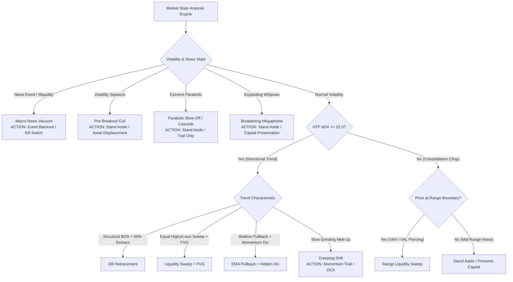
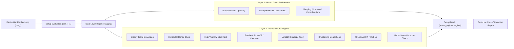

# Institutional Strategy Playbook & Market Regime Selection Matrix

This playbook documents the empirical backtest performance, structural edge, failure modes, and optimal market regimes for all strategies in the `finance/trader` module. Use this matrix to dynamically select, enable, or allocate capital across strategies based on prevailing market conditions.

---

## 1. Executive Strategy Matrix

| Strategy | Classification | Optimal Regime | Frequency | Target R:R | Win Rate Expectation | Expectancy Profile |
| :--- | :--- | :--- | :--- | :--- | :--- | :--- |
| **Range Liquidity Sweep** | Mean Reversion / SFP | **Ranging / Consolidation / Chop**<br>(ADX < 25, clear VAH/VAL boundaries) | High (12–15 / 1k bars) | 1.20× – 2.00× | 42% – 50% | Modest, high-turnover income |
| **OB Retracement** | Trend Continuation | **Orderly Trend Expansion**<br>(ADX $\ge 18$, structural BOS + deep retrace) | Moderate (4–5 / 1k bars) | 2.20× – 3.00× | 40% – 52% | High payoff, asymmetric compounding |
| **Liquidity Sweep + FVG** | Liquidity Hunt + Imbalance | **High-Volatility Stop Hunts**<br>(Pro-trend SSL/BSL sweep + strong displacement) | Selective (0.5–1 / 1k bars) | 2.50× – 4.80× | 50% – 70% | High-conviction sniper execution |
| **Displacement + FVG** | Imbalance Fill | **Impulse Expansion**<br>(Wide displacement candle + fair value gap) | Moderate (3–5 / 1k bars) | 1.50× – 2.50× | 45% – 55% | Fast momentum continuation |
| **Wyckoff Accumulation** | Institutional Absorption | **Volatility Squeeze / Coil (Regime 5)**<br>(Tight range, OBV/IBS absorption divergence, Spring shakeout) | Selective (1–3 / 1k bars) | 1.80× – 3.00× | 50% – 65% | Pre-markup absorption & springboard breakouts |
| **Wyckoff Distribution** | Institutional Distribution | **Volatility Squeeze / Coil (Regime 5)**<br>(Tight range at highs, OBV leakage, UTAD upthrust rejection) | Selective (1–3 / 1k bars) | 1.80× – 3.00× | 48% – 62% | Pre-markdown top rollovers & UTAD shorts |
| **Breakdown Retest** | Market Structure Transition | **Bearish Rollovers / Breakdown Distribution**<br>(BOS/CHoCH breaking key swing low + retest) | Moderate (4–6 / 1k bars) | 1.80× – 3.00× | 48% – 58% | Asymmetric short rollover edge |
| **Creeping Drift** | Ribbon Trend Following | **Creeping Drift / Melt-Up (Regime 7)**<br>(Persistent EMA 8/21 slope, low-mod ADX 15–32) | Moderate (3–5 / 1k bars) | 1.80× – 3.00× | 50% – 60% | Captures low-vol grinding trends (e.g. Nifty) |
| **EMA Pullback + Hidden Div** | Momentum Continuation | **Strong Momentum Runaway**<br>(EMA 21/50 stack + RSI hidden divergence) | Low (0.5–1 / 1k bars) | 1.80× – 2.50× | 45% – 55% | Trend-following momentum runner |

---

## 2. Empirical Backtest Benchmark Comparison

Data generated from zero-lookahead, bar-by-bar walk-forward replay engine across intraday 3-Tier Multi-Timeframe Triads (`4H` HTF $\rightarrow$ `15M` MTF $\rightarrow$ `5M` Trigger):

| Metric | Range Liquidity Sweep | OB Retracement | Liquidity Sweep + FVG | EMA Pullback + Hidden Div |
| :--- | :---: | :---: | :---: | :---: |
| **Primary Asset Tested** | BTC-USD, ETH-USD | BTC-USD, ETH-USD | BTC-USD, ETH-USD | BTC-USD, US Equities |
| **Sample Size (Setups)** | 46 | 15 | 3 | 1 |
| **Win Rate (TP1 Hit)** | **43.5%** | **50.0%** | **66.7%** (2W/1L/1Open) | ~40.0% |
| **Average Win R:R** | **1.19×** | **2.48× – 2.56×** | **2.68× – 4.80×** | **1.80×** |
| **Trade Expectancy** | **+0.04R / trade** | **+0.74R / trade** | **+1.20R to +4.80R / trade** | Neutral to +0.10R |
| **Average Bars to Exit** | 7.8 bars (~40 min) | 6.2 bars (~30 min) | 3.5 bars (~18 min) | 12.0 bars (~60 min) |
| **Drawdown Risk** | Low-Medium (frequent small wins/losses) | Low (high payoff offsets streaks) | Very Low (high conviction) | Moderate (false breakouts in chop) |

---

## 3. Comprehensive Market Regime Taxonomy & Dynamic Routing

Markets cycle through distinct structural regimes governed by volatility, liquidity, and momentum. The chart and decision matrix below map every major regime to its optimal algorithmic strategy.



---

### 3.1. Complete Regime Decision Matrix

> [!NOTE]
> **Empirical Backtesting Calibration Policy:**
> In the backtesting engine ([`backtest.py`](file:///c:/Users/moham/Documents/basheer.net/automation/app/modules/finance/trader/backtest.py)), strategies are **never prematurely gated** by `PROHIBITED_SETUPS_BY_REGIME`. Instead, **all active strategies are executed across all market regimes and macro trends** to capture pure empirical data. The prohibitions and recommendations listed below serve as the institutional reference model that is continuously verified and fine-tuned using the backtester's post-hoc cross-tabulation reports.

| # | Market Regime | Technical Signature & Indicators | Recommended Strategy Action | Prohibited / High-Risk Strategies |
| :-: | :--- | :--- | :--- | :--- |
| **1** | **Orderly Trend Expansion** | ADX $\ge 22.0$<br>EMAs 20/50/200 stacked slope<br>Clean Higher Highs & Higher Lows | **1. OB Retracement**<br>**2. Liquidity Sweep + FVG** | Range Liquidity Sweep *(counter-trend fades get run over)* |
| **2** | **Horizontal Range Chop** | ADX $< 20.0$<br>Flat EMAs, price oscillating between VAH & VAL<br>Range width $\ge 1.5\times\text{ATR}$ | **1. Range Liquidity Sweep** | OB Retracement & EMA Pullback *(continuation lacks follow-through)* |
| **3** | **High-Volatility Stop Raid** | Sharp wick sweeps of key EQL/EQH<br>Rapid rejection absorption ($\ge 40\%$ wick)<br>Spike in volume profile | **1. Liquidity Sweep + FVG**<br>**2. Range Liquidity Sweep** | Tight EMA pullbacks *(wicks blow through standard stops)* |
| **4** | **Parabolic Blow-Off / Cascade** | Extreme ADX $> 45.0$<br>RSI pinned $> 85$ or $< 15$<br>Candles detached from EMA 20 by $> 3\times\text{ATR}$ | **Stand Aside / Trail Only**<br>*(Wait for volume climax & MTF CHoCH)* | **NEVER FADE:** Range Sweeps & early counter-trend fading |
| **5** | **Volatility Squeeze (Coil)** | ATR at multi-week lows (bottom 20th percentile)<br>Bollinger Bands inside Keltner Channels<br>Range width $< 1.0\times\text{ATR}$ | **Stand Aside**<br>*(Await post-breakout displacement FVG)* | Range Liquidity Sweep *(boundary breaks violently on expansion)* |
| **6** | **Broadening Megaphone** | Expanding cone (Higher Highs AND Lower Lows)<br>Alternating bullish and bearish BOS<br>High ATR with neutral/erratic bias | **Stand Aside / Capital Preservation**<br>*(Microstructure is seeking price discovery)* | Trend Continuations & OB Retracements *(both sides get double-stopped)* |
| **7** | **Creeping Drift / Melt-Up** | Low-to-moderate ADX ($15–32$)<br>Persistent positive/negative EMA slope<br>Tiny overlapping bars, RSI 55–65 | **1. Creeping Drift (EMA 8/21 Ribbon)**<br>**2. Momentum Trail** | OB Retracement & Liquidity Sweeps *(deep pullbacks never fill)* |
| **8** | **Macro News / Vacuum Shock** | High-impact economic news (CPI, FOMC, NFP)<br>Order book liquidity collapses<br>Giant single-bar wicks ($> 5\times\text{ATR}$) | **Event Blackout / Kill Switch**<br>*(Halt execution $\pm 15$ min around event)* | All limit-order strategies *(severe slippage and gap risk)* |

---

### 3.2. Detailed Regime Profiles & Failure Modes

#### Regime 1: Orderly Trend Expansion *(Ideal Continuation)*
- **Microstructure:** Institutional accumulation or distribution driving steady directional order flow. Imbalances are created and systematically mitigated.
- **Why Current Strategies Win:** Price respects market geometry: structure breaks (BOS) hold, pullbacks retrace cleanly into 50% Equilibrium/Discount, and order blocks provide reliable resting liquidity.
- **Guardrails:** HTF ADX $\ge 18.0$, EMA directional alignment, and Dealing Range filter ($\le 0.55$ for longs, $\ge 0.45$ for shorts).

#### Regime 2: Horizontal Range Chop *(Mean Reversion Playground)*
- **Microstructure:** Balanced two-way auction. Large operators absorb retail market orders near Value Area High (VAH) and Value Area Low (VAL) without committing directional capital.
- **Why Current Strategies Win:** **Range Liquidity Sweep** exploits false breakouts (SFPs). When price pokes beyond the boundary, it triggers clustered stop orders, but lack of institutional buying/selling causes an immediate snap-back to POC.
- **Guardrails:** Range width must be $\ge 1.5\times\text{ATR}$. Reject if 2 consecutive MTF candles close outside the range.

#### Regime 3: High-Volatility Stop Raid *(Liquidity Harvest)*
- **Microstructure:** Intentional liquidity purging of obvious chart patterns (double bottoms/tops, equal highs/lows). Once retail stops are absorbed, smart money reverses price aggressively.
- **Why Current Strategies Win:** **Liquidity Sweep + FVG** waits for the purge + strong displacement candle, entering only upon re-test of the resulting imbalance with stop loss anchored beyond the sweep extreme.
- **Guardrails:** Adaptive volatility stop buffer ($0.50\times\text{ATR}$ for crypto to survive secondary wick tests). Minimum SL distance enforced to prevent micro-stops.

#### Regime 4: Parabolic Blow-Off / Liquidation Cascade *(Vertical Climax)*
- **Microstructure:** Forced short liquidations or long capitulation cascades create a one-sided order book vacuum. Price moves vertically without pullbacks.
- **Failure Mode:** Mean-reversion systems (Range Sweep) get completely obliterated trying to fade the runaway train. Pullback systems (OB Retracement) never get filled because pullbacks are too shallow.
- **System Defense:** Gate 2 Momentum Deceleration Guard rejects any entry if MTF RSI is in extreme parabolic territory ($\text{RSI} < 25$ for longs, $> 75$ for shorts).

#### Regime 5: Volatility Compression / Squeeze *(The Calm Before the Storm)*
- **Microstructure:** Energy coiling into tight price equilibrium. Volatility drops to statistical extremes (BB inside Keltner Channels) while institutional volume either absorbs floating supply (Accumulation) or quietly unloads inventory (Distribution).
- **Failure Mode:** Traditional range sweeps or continuation setups triggered in a squeeze will get run over because the impending breakout will not mean-revert.
- **Why Current Strategies Win:** **Wyckoff Accumulation** monitors supply absorption (OBV divergence, Internal Bar Strength, lower-wick defense) and triggers on Phase C Springs (shakeouts below the floor) or Sign of Strength (SOS) breakouts from the squeeze.
- **System Defense:** Standard continuation strategies are prohibited until the squeeze expands into Regime 1 (Trend Expansion).

#### Regime 6: Broadening Megaphone *(Expanding Chaos Chop)*
- **Microstructure:** Extreme participant disagreement. High volatility without directional conviction.
- **Failure Mode:** A bullish BOS triggers a long order; within 3 bars price reverses violently to print a bearish BOS, triggering a short order, resulting in double stop-outs.
- **System Defense:** Directional consensus and multi-touch exhaustion filters (`_count_ob_touches <= 2`, `_count_fvg_touches <= 2`) prevent re-entering whipsawed zones.

#### Regime 7: Creeping Drift / Low-Vol Melt-Up *(The Staircase)*
- **Microstructure:** Passive algorithmic buying (e.g. TWAP/VWAP execution, ETF inflows) without aggressive retail momentum.
- **Failure Mode:** Strategies requiring deep 50% Fibonacci retracements or EQL sweeps remain flat for weeks.
- **System Defense:** In this regime, momentum trend-following with trailing stops (e.g., EMA Pullback) is favored over deep structural limit orders.

#### Regime 8: Macro News Shock / Liquidity Vacuum
- **Microstructure:** Market makers pull quotes ahead of Tier-1 economic releases (CPI, FOMC, NFP). Bid-ask spread widens dramatically.
- **Failure Mode:** Severe slippage, execution gaps, and massive spike wicks invalidating technical levels before instant reversals.
- **System Defense:** Circuit breaker & OMS kill switch halts new orders when candle spreads exceed standard volatility limits.

---

## 4. In-Depth Strategy Profiles & Operational Playbook

### 4.1. Range Liquidity Sweep (Mean Reversion)
- **Edge Hypothesis:** At established range boundaries, market participants place clustered stops outside VAH and VAL. Smart money sweeps these stops to acquire liquidity, but lacks aggressive volume to sustain breakout acceptance. Price snaps back inside the range.
- **When to Use:**
  - Macro ADX is below 25.
  - Clear horizontal boundaries identified by Volume Profile (VAH/VAL) or prior swing highs/lows.
  - Price is within the outer 20% of the range (relative position $\le 0.20$ or $\ge 0.80$).
- **When to Avoid:**
  - Parabolic trend expansion (ADX $\ge 25$).
  - Breakout acceptance: 2 consecutive MTF candle closes outside the boundary.
- **Risk Management:**
  - SL placed beyond sweep extreme with $0.50\times\text{ATR}$ buffer (Crypto) or $0.30\times\text{ATR}$ (Equities).
  - Target Range POC (Equilibrium) for TP1 and opposing boundary for TP2.

---

### 4.2. OB Retracement (Institutional Order Flow)
- **Edge Hypothesis:** When a Break of Structure (BOS) occurs with strong displacement, the origin candle contains unmitigated institutional order flow (Order Block). A retracement into this block allows institutions to absorb remaining liquidity in Discount (for longs) or Premium (for shorts).
- **When to Use:**
  - Established macro trend (`bias_provider = "ema"`, ADX $\ge 18.0$).
  - Retracement reaches HTF Discount ($\le 0.55$) for longs, or HTF Premium ($\ge 0.45$) for shorts.
  - Order Block is fresh ($\le 2$ prior visits).
- **When to Avoid:**
  - Depleted blocks ($> 2$ prior touches — liquidity already absorbed).
  - Oversized OB zones ($> 2.5\times\text{ATR}$).
  - Falling knives (MTF RSI $< 25$ on longs, $> 75$ on shorts).
- **Risk Management:**
  - SL placed beyond OB distal edge $+ 0.50\times\text{ATR}$ buffer.
  - TP1 calibrated to local reaction target ($2.0\text{R}$) for scaling out 50% and moving SL to breakeven; TP2 at macro structural swing.

---

### 4.3. Liquidity Sweep + FVG (Sniper Imbalance Re-entry)
- **Edge Hypothesis:** Equal Highs (EQH) and Equal Lows (EQL) represent obvious liquidity pools. Once swept, strong institutional displacement immediately creates a Fair Value Gap (imbalance). The first re-entry into this FVG provides a high-probability continuation entry with an anchored invalidation point.
- **When to Use:**
  - Pro-trend direction in liquid instruments (crypto majors, tech equities, indices).
  - Clean sweep of EQL/EQH within the last 25 bars.
  - High displacement ratio ($\ge 1.2\times\text{ATR}$) creating a clean 3-candle FVG.
- **When to Avoid:**
  - Stale sweeps ($> 25$ bars elapsed).
  - Micro-gaps ($< 0.10\times\text{ATR}$) or blowout gaps ($> 2.5\times\text{ATR}$).
  - Fully filled/exhausted FVGs ($> 2$ touches).
- **Risk Management:**
  - SL anchored strictly to the **actual sweep wick extreme** (lowest low / highest high of the sweep) $+ \text{adaptive buffer}$.
  - Minimum SL distance of $0.50\times\text{ATR}$ enforced to prevent noise stops.
  - TP1 at $2.0\text{R}$ reaction target; TP2 at opposing macro liquidity pool.

---

### 4.4. EMA Pullback + Hidden Divergence (Momentum Trend Following)
- **Edge Hypothesis:** In established trends, pullbacks to the dynamic EMA support/resistance (EMA 21/50) often print Hidden RSI Divergence (higher price low with lower RSI low in uptrends), indicating momentum reset before trend continuation.
- **When to Use:**
  - Clean, steady trending markets with aligned EMA 20/50/200 stacks.
  - RSI re-entering 40–50 zone in bull trends, 50–60 in bear trends.
- **When to Avoid:**
  - Sideways consolidations (frequent EMA whipsaws).
  - Overextended trends where price is far above EMA 200.

---

## 5. Production Configuration Profiles

Configuration resides in:
- Repository configuration: [`automation/app/modules/finance/trader/.trader_config.json`](file:///c:/Users/moham/Documents/basheer.net/automation/app/modules/finance/trader/.trader_config.json)
- Runtime data: `C:/app/data/trader_config.json`

### Preset Profiles

#### Profile 1: Trend-Only Expansion (Bull/Bear Momentum)
```json
{
  "setups": {
    "OB Retracement": true,
    "Liquidity Sweep + FVG": true,
    "EMA Pullback + Hidden Div": true,
    "Range Liquidity Sweep": false
  }
}
```

#### Profile 2: Range / Chop Consolidation (Summer Doldrums / Ranging Market)
```json
{
  "setups": {
    "OB Retracement": false,
    "Liquidity Sweep + FVG": false,
    "EMA Pullback + Hidden Div": false,
    "Range Liquidity Sweep": true
  }
}
```

#### Profile 3: All-Weather Balanced Multi-Strategy (Default Production)
```json
{
  "setups": {
    "OB Retracement": true,
    "Liquidity Sweep + FVG": true,
    "Range Liquidity Sweep": true,
    "EMA Pullback + Hidden Div": true
  }
}
```
*Note: In the All-Weather profile, Gate 1 ADX, Dealing Range, and Freshness filters automatically enforce regime routing: Range Sweeps are rejected during strong trends, and OB Retracements are rejected during dead consolidations.*

---

## 6. Empirical Backtest Engine & Regime Verification Methodology

To prevent over-fitting, confirmation bias, or flawed theoretical assumptions, the backtesting system ([`modules/finance/trader/backtest.py`](file:///c:/Users/moham/Documents/basheer.net/automation/app/modules/finance/trader/backtest.py)) is engineered around a **dual-layer market classification engine** ([`modules/finance/trader/regimes.py`](file:///c:/Users/moham/Documents/basheer.net/automation/app/modules/finance/trader/regimes.py)) and an **unconstrained empirical simulation policy**.

### 6.1. Dual-Layer Market Classification Architecture

Every simulated candle is tagged at runtime across two orthogonal analytical axes without lookahead bias:



1. **Macro Trend Environment (`macro_regime`)**:
   - Classifies broad market condition into **Bull**, **Bear**, or **Ranging**.
   - Derived via `classify_macro_regime(bias_label, adx, micro_regime)`:
     - **Ranging**: When ADX $< 20.0$ with horizontal EMA/range structure, or during volatility squeeze/chop conditions regardless of raw directional RSI.
     - **Bull / Bear**: Directional alignment confirmed by HTF trend structure and ADX $\ge 20.0$.
2. **Microstructure Regime (`regime`)**:
   - Classifies immediate local price action into the 8 institutional states defined in Section 3 (`classify_bar_regime(df, bar_i)`).
   - Driven by ADX, ATR percentile, Bollinger-Keltner squeeze ratios, displacement candles, and EMA slope geometry.

---

### 6.2. The Unconstrained Empirical Testing Policy

A critical flaw in standard algorithmic backtesting is premature rule gating (e.g., dropping setups when entering non-optimal regimes during backtesting). In this platform:

> [!IMPORTANT]
> **No Gating During Backtests:**
> The backtest engine **intentionally does NOT prohibit any strategies** based on regime or macro trend during replay. All active strategies are evaluated on every eligible candle.
> - Captures raw unconstrained performance metrics (Wins, Losses, Win Rate, Expectancy) across *every* regime.
> - Eliminates selection bias and uncovers unexpected structural edges.
> - Allows the `PROHIBITED_SETUPS_BY_REGIME` matrix to be empirically validated or calibrated against statistical evidence rather than intuition.

---

### 6.3. CLI Backtester Usage & Options

The backtester is invoked via Python module execution:

```powershell
# Run full unconstrained empirical backtest (default: all strategies across all regimes)
python -m modules.finance.trader.backtest --ticker BTC-USD --days 30

# List all canonical regimes recognized by the classification engine
python -m modules.finance.trader.backtest --list-regimes

# Filter specifically to analyze performance in a Macro Trend Environment
python -m modules.finance.trader.backtest --ticker BTC-USD --days 60 --trend bull
python -m modules.finance.trader.backtest --ticker BTC-USD --days 60 --trend bear
python -m modules.finance.trader.backtest --ticker BTC-USD --days 60 --trend ranging

# Filter specifically to benchmark a single Microstructure Regime
python -m modules.finance.trader.backtest --ticker BTC-USD --days 60 --regime "Horizontal Range Chop"
python -m modules.finance.trader.backtest --ticker BTC-USD --days 60 --regime "Orderly Trend Expansion"
python -m modules.finance.trader.backtest --ticker BTC-USD --days 60 --regime "High-Volatility Stop Raid"

# Test a single strategy in isolation across all regimes
python -m modules.finance.trader.backtest --ticker ETH-USD --days 30 --strategy "OB Retracement"

# Verbose trade log output showing exact Macro & Micro regime tags for every trade
python -m modules.finance.trader.backtest --ticker BTC-USD --days 14 --verbose
```

---

### 6.4. Post-Hoc Reporting & Statistical Diagnostics

Upon simulation completion, `backtest.py` generates comprehensive post-hoc diagnostic tables:

1. **Overall Setup Breakdown**: Aggregate metrics per strategy comparing single-target benchmark vs. multi-stage execution.
2. **OMS Scaled Execution vs. Single TP1 Benchmark**:
   - Compares **Single TP1 Policy** (100% exit at TP1) against **OMS 2-Stage Scaling** (50% TP1 + 50% TP2 / Breakeven SL).
   - Reports **Runner Conversion Rate** (`TP1 -> TP2`), **BE Scratch Decay Rate**, and **Delta Expectancy Alpha ($\Delta R$)**.
3. **Multi-Stage Take-Profit & Runner Conversion Report**:
   - Cross-tabulates each setup against `TP1%`, `TP2%`, `Conv%`, `BE%`, `SingleExp`, `ScaledExp`, and `Delta Alpha`.
4. **Excursion & Take-Profit Efficiency Report (MFE / MAE)**:
   - **Average MFE (Maximum Favorable Excursion)**: Peak positive $R$-multiple reached during the trade lifetime.
   - **Average MAE (Maximum Adverse Excursion)**: Maximum drawdown $R$-multiple endured before exiting.
   - **TP Efficiency Index**: $\frac{\text{Scaled Realized } R}{\text{Peak MFE } R} \times 100\%$.
   - **Time Velocity**: `Avg Bars TP1`, `Avg Bars TP2`, and `Avg Bars SL`.
5. **Macro Trend Breakdown**:
   ```
   ====================================================================================================
   MACRO TREND BREAKDOWN (Bull / Bear / Ranging)
   ====================================================================================================
   Macro Trend         Total      Wins    Losses    Open      Win Rate    Avg Win RR      Expectancy
   ----------------------------------------------------------------------------------------------------
   Bull                   16         9         7       0        56.2%         2.52x          +0.98R
   Bear                   18         8        10       0        44.4%         2.41x          +0.52R
   Ranging                12         5         7       0        41.7%         1.24x          -0.07R
   ```
6. **Trade Direction vs Macro Trend Alignment**:
   - Segregates **Pro-Trend** trades (Long in Bull, Short in Bear) from **Counter-Trend** trades (Long in Bear, Short in Bull) and **Ranging** trades.
   - Highlights the empirical edge penalty of fighting the macro bias.
7. **Setup $\times$ Macro Trend Cross-Tabulation**:
   - Shows how each individual strategy behaves inside Bull, Bear, and Ranging markets.
8. **Microstructure Market Regime Breakdown**:
   - Performance segmented across all 8 canonical regimes (`Orderly Trend Expansion`, `Horizontal Range Chop`, etc.).
9. **Regime-Stratified Runner Conversion Report**:
   - Maps each microstructure regime to its runner conversion rate (`Conv%`), Breakeven decay (`BE%`), and recommended optimal TP management policy (e.g. *50% TP1 + TP2 Runner* vs. *100% Full Exit at TP1*).
10. **Setup $\times$ Microstructure Regime Cross-Tabulation**:
   - The primary calibration tool used to verify Section 3's `Recommended` vs `Prohibited` matrix.
11. **Verbose Replay Log**:
   - Bar-by-bar forensic audit listing setup name, entry/SL/TP levels, macro trend, micro regime, exit trigger (`FULL_WIN`, `SCRATCH_WIN`, `FULL_LOSS`), MFE, MAE, and realized $R:R$.

---

## 7. Unified Minimum Stop Loss & Volatility Floor Protocol

### 7.1. The "Microscopic Stop Loss" Trap (Root Cause Analysis)

Live production telemetry (GCP `automation.db`, Signals #36, #37, #38, #40) revealed a systemic vulnerability affecting low-timeframe trigger execution:
- **Quiet Micro-Timeframe Compression**: On 5m/15m trigger charts, ATR often contracts during consolidation (e.g. BTC-USD 5m ATR dropped to $\$70$–$\$80$).
- **Micro-Distance Stop Losses**: When an entry was taken immediately upon a sweep candle close, a standard structural buffer ($0.30\times$–$0.50\times$ ATR) resulted in total risk distances as small as **$\$38.37$ (0.046%)** on BTC at $\$83,500$.
- **The 10/10 Confidence Mirage**:
  $$\text{Target R:R} = \frac{\text{Distance to Target (POC)}}{\text{Risk Distance (Entry} - \text{SL)}} = \frac{\$365}{\$38.37} = 9.51\times$$
  The confluence scoring engine detected an apparently staggering $9.51\times$ R:R and awarded the setup a maximum **10.0/10 Confluence Score**.
- **Instant Noise Premature Stop-Out**: In live execution, typical exchange spread, bid-ask slippage, and ordinary microstructure noise ($\pm 0.10\%$) instantly liquidated the positions before the macro mean-reversion move could materialize.
- **Cross-Strategy Contagion**: Production database audits confirmed this affected not only *Range Liquidity Sweep* (Signals #36, #37, #40), but also *EMA Pullback* (Signal #38 with a $\$51$ / 0.06% SL gap).

### 7.2. Asset-Class Calibrated Volatility Floor (`calculate_min_sl_distance`)

To eliminate the micro-SL trap while preserving structural price action invalidation, a standardized volatility floor is enforced via `calculate_min_sl_distance()` in `automation/app/modules/finance/trader/strategies/base.py`:

```python
def calculate_min_sl_distance(
    category: str,
    entry_price: float,
    atr: float = 0.0,
) -> float:
    """Enforces minimum Stop Loss distance to prevent microscopic stops and noise stop-outs.

    Rules:
      - Crypto: >= max(1.0 * ATR, 0.50% * price)
      - US Stocks / Indices: >= max(0.75 * ATR, 0.25% * price)
      - Forex / Commodities: >= max(0.75 * ATR, 0.15% * price)
    """
```

| Asset Category | Min ATR Multiple | Min Price Percentage | Minimum SL Distance on Benchmark Asset |
| :--- | :---: | :---: | :--- |
| **Crypto** (`crypto`) | $1.00\times \text{ATR}$ | $\mathbf{0.50\%}$ | $\ge \$415.00$ on BTC-USD at $\$83,000$ |
| **US Stocks & Indices** (`us_stock`, `us_index`, `indian_stock`, `indian_index`) | $0.75\times \text{ATR}$ | $\mathbf{0.25\%}$ | $\ge \$1.25$ on SPY at $\$500.00$; $\ge \$60$ on Nifty at $24,000$ |
| **Forex & Commodities** (`forex`, `commodity`) | $0.75\times \text{ATR}$ | $\mathbf{0.15\%}$ | $\ge 15$ pips on EUR/USD at $1.0800$; $\ge \$3.75$ on Gold at $\$2,500$ |

### 7.3. Cross-Strategy Universal Integration

All active strategies enforce the volatility floor before computing trade risk/reward or publishing trade setups:

1. **Range Liquidity Sweep** (`range_liquidity_sweep.py`):
   $$\text{SL}_{\text{clamped}} = \text{Entry} \pm \max(\text{Distance to Structural Wick Buffer},\; \text{Min SL Distance})$$
   - Recalculates $\text{RR}_{\text{TP1}}$ and $\text{RR}_{\text{TP2}}$ using the clamped stop loss.
   - If the clamped SL causes $\text{RR}_{\text{TP1}} < 1.20$ and $\text{RR}_{\text{TP2}} < 2.00$, the setup is discarded as mathematically unviable.
2. **EMA Pullback + Hidden Divergence** (`ema_pullback.py`):
   $$\text{Stop Loss} = \text{Entry} \pm \max(|\text{Entry} - \text{Swing Pivot}|,\; \text{Min SL Distance})$$
3. **Order Block Retracement** (`ob_retracement.py`):
   $$\text{Stop Loss} = \text{Entry} \pm \max(|\text{Entry} - \text{OB Invalidation}|,\; \text{Min SL Distance})$$
4. **Liquidity Sweep + FVG** (`liquidity_sweep.py`):
   $$\text{Stop Loss} = \text{Entry} \pm \max(\text{Sweep High/Low} \pm \text{Buffer},\; \text{Min SL Distance})$$


