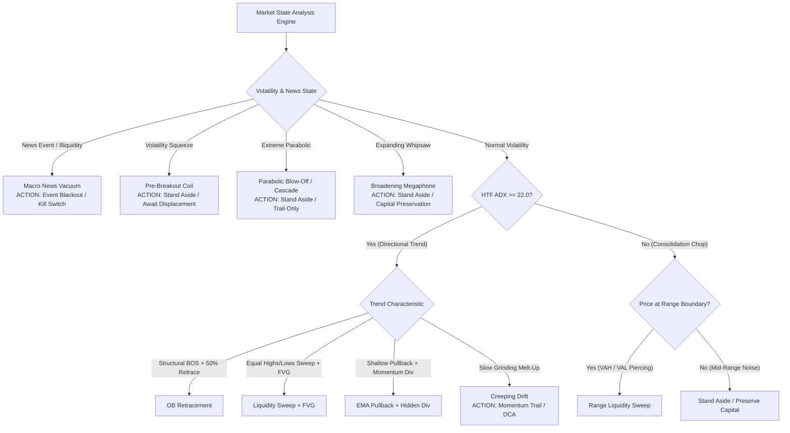

# Institutional Strategy Playbook & Market Regime Selection Matrix

This playbook documents the empirical backtest performance, structural edge, failure modes, and optimal market regimes for all strategies in the `finance/trader` module. Use this matrix to dynamically select, enable, or allocate capital across strategies based on prevailing market conditions.

---

## 1. Executive Strategy Matrix

| Strategy | Classification | Optimal Regime | Frequency | Target R:R | Win Rate Expectation | Expectancy Profile |
| :--- | :--- | :--- | :--- | :--- | :--- | :--- |
| **Range Liquidity Sweep** | Mean Reversion / SFP | **Ranging / Consolidation / Chop**<br>(ADX < 25, clear VAH/VAL boundaries) | High (12–15 / 1k bars) | 1.20× – 2.00× | 42% – 50% | Modest, high-turnover income |
| **OB Retracement** | Trend Continuation | **Orderly Trend Expansion**<br>(ADX $\ge 18$, structural BOS + deep retrace) | Moderate (4–5 / 1k bars) | 2.20× – 3.00× | 40% – 52% | High payoff, asymmetric compounding |
| **Liquidity Sweep + FVG** | Liquidity Hunt + Imbalance | **High-Volatility Stop Hunts**<br>(Pro-trend SSL/BSL sweep + strong displacement) | Selective (0.5–1 / 1k bars) | 2.50× – 4.80× | 50% – 70% | High-conviction sniper execution |
| **EMA Pullback + Hidden Div** | Momentum Continuation | **Strong Momentum Runaway**<br>(EMA 21/50 stack + RSI hidden divergence) | Low (0.5–1 / 1k bars) | 1.80× – 2.50× | 45% – 55% | Trend-following momentum runner |

---

## 2. Empirical Backtest Benchmark Comparison

Data generated from zero-lookahead, bar-by-bar walk-forward replay engine across intraday 3-Tier Multi-Timeframe Triads (`4H` HTF $\rightarrow$ `15M` MTF $\rightarrow$ `5M` Trigger):

| Metric | Range Liquidity Sweep | OB Retracement | Liquidity Sweep + FVG | EMA Pullback + Hidden Div |
| :--- | :---: | :---: | :---: | :---: |
| **Primary Asset Tested** | BTC-USD, ETH-USD | BTC-USD, ETH-USD | BTC-USD, ETH-USD | BTC-USD, US Equities |
| **Sample Size (Setups)** | 46 | 15 | 3 | 1 |
| **Win Rate (TP1 Hit)** | **43.5%** | **50.0%** | **66.7%** (2W/1L/1Open) | ~40.0% |
| **Average Win R:R** | **1.19×** | **2.48× – 2.56×** | **2.68× – 4.80×** | **1.80×** |
| **Trade Expectancy** | **+0.04R / trade** | **+0.74R / trade** | **+1.20R to +4.80R / trade** | Neutral to +0.10R |
| **Average Bars to Exit** | 7.8 bars (~40 min) | 6.2 bars (~30 min) | 3.5 bars (~18 min) | 12.0 bars (~60 min) |
| **Drawdown Risk** | Low-Medium (frequent small wins/losses) | Low (high payoff offsets streaks) | Very Low (high conviction) | Moderate (false breakouts in chop) |

---

## 3. Comprehensive Market Regime Taxonomy & Dynamic Routing

Markets cycle through distinct structural regimes governed by volatility, liquidity, and momentum. The chart and decision matrix below map every major regime to its optimal algorithmic strategy.



---

### 3.1. Complete Regime Decision Matrix

| # | Market Regime | Technical Signature & Indicators | Recommended Strategy Action | Prohibited / High-Risk Strategies |
| :-: | :--- | :--- | :--- | :--- |
| **1** | **Orderly Trend Expansion** | ADX $\ge 22.0$<br>EMAs 20/50/200 stacked slope<br>Clean Higher Highs & Higher Lows | **1. OB Retracement**<br>**2. Liquidity Sweep + FVG** | Range Liquidity Sweep *(counter-trend fades get run over)* |
| **2** | **Horizontal Range Chop** | ADX $< 20.0$<br>Flat EMAs, price oscillating between VAH & VAL<br>Range width $\ge 1.5\times\text{ATR}$ | **1. Range Liquidity Sweep** | OB Retracement & EMA Pullback *(continuation lacks follow-through)* |
| **3** | **High-Volatility Stop Raid** | Sharp wick sweeps of key EQL/EQH<br>Rapid rejection absorption ($\ge 40\%$ wick)<br>Spike in volume profile | **1. Liquidity Sweep + FVG**<br>**2. Range Liquidity Sweep** | Tight EMA pullbacks *(wicks blow through standard stops)* |
| **4** | **Parabolic Blow-Off / Cascade** | Extreme ADX $> 45.0$<br>RSI pinned $> 85$ or $< 15$<br>Candles detached from EMA 20 by $> 3\times\text{ATR}$ | **Stand Aside / Trail Only**<br>*(Wait for volume climax & MTF CHoCH)* | **NEVER FADE:** Range Sweeps & early counter-trend fading |
| **5** | **Volatility Squeeze (Coil)** | ATR at multi-week lows (bottom 20th percentile)<br>Bollinger Bands inside Keltner Channels<br>Range width $< 1.0\times\text{ATR}$ | **Stand Aside**<br>*(Await post-breakout displacement FVG)* | Range Liquidity Sweep *(boundary breaks violently on expansion)* |
| **6** | **Broadening Megaphone** | Expanding cone (Higher Highs AND Lower Lows)<br>Alternating bullish and bearish BOS<br>High ATR with neutral/erratic bias | **Stand Aside / Capital Preservation**<br>*(Microstructure is seeking price discovery)* | Trend Continuations & OB Retracements *(both sides get double-stopped)* |
| **7** | **Creeping Drift / Melt-Up** | Low-to-moderate ADX ($15–20$)<br>Persistent positive/negative EMA slope<br>Tiny overlapping bars, RSI 55–65 | **Momentum Trail**<br>*(Shallow EMA 9/21 re-tests; avoid deep 50% limit bids)* | OB Retracement & Liquidity Sweeps *(deep pullbacks never fill)* |
| **8** | **Macro News / Vacuum Shock** | High-impact economic news (CPI, FOMC, NFP)<br>Order book liquidity collapses<br>Giant single-bar wicks ($> 5\times\text{ATR}$) | **Event Blackout / Kill Switch**<br>*(Halt execution $\pm 15$ min around event)* | All limit-order strategies *(severe slippage and gap risk)* |

---

### 3.2. Detailed Regime Profiles & Failure Modes

#### Regime 1: Orderly Trend Expansion *(Ideal Continuation)*
- **Microstructure:** Institutional accumulation or distribution driving steady directional order flow. Imbalances are created and systematically mitigated.
- **Why Current Strategies Win:** Price respects market geometry: structure breaks (BOS) hold, pullbacks retrace cleanly into 50% Equilibrium/Discount, and order blocks provide reliable resting liquidity.
- **Guardrails:** HTF ADX $\ge 18.0$, EMA directional alignment, and Dealing Range filter ($\le 0.55$ for longs, $\ge 0.45$ for shorts).

#### Regime 2: Horizontal Range Chop *(Mean Reversion Playground)*
- **Microstructure:** Balanced two-way auction. Large operators absorb retail market orders near Value Area High (VAH) and Value Area Low (VAL) without committing directional capital.
- **Why Current Strategies Win:** **Range Liquidity Sweep** exploits false breakouts (SFPs). When price pokes beyond the boundary, it triggers clustered stop orders, but lack of institutional buying/selling causes an immediate snap-back to POC.
- **Guardrails:** Range width must be $\ge 1.5\times\text{ATR}$. Reject if 2 consecutive MTF candles close outside the range.

#### Regime 3: High-Volatility Stop Raid *(Liquidity Harvest)*
- **Microstructure:** Intentional liquidity purging of obvious chart patterns (double bottoms/tops, equal highs/lows). Once retail stops are absorbed, smart money reverses price aggressively.
- **Why Current Strategies Win:** **Liquidity Sweep + FVG** waits for the purge + strong displacement candle, entering only upon re-test of the resulting imbalance with stop loss anchored beyond the sweep extreme.
- **Guardrails:** Adaptive volatility stop buffer ($0.50\times\text{ATR}$ for crypto to survive secondary wick tests). Minimum SL distance enforced to prevent micro-stops.

#### Regime 4: Parabolic Blow-Off / Liquidation Cascade *(Vertical Climax)*
- **Microstructure:** Forced short liquidations or long capitulation cascades create a one-sided order book vacuum. Price moves vertically without pullbacks.
- **Failure Mode:** Mean-reversion systems (Range Sweep) get completely obliterated trying to fade the runaway train. Pullback systems (OB Retracement) never get filled because pullbacks are too shallow.
- **System Defense:** Gate 2 Momentum Deceleration Guard rejects any entry if MTF RSI is in extreme parabolic territory ($\text{RSI} < 25$ for longs, $> 75$ for shorts).

#### Regime 5: Volatility Compression / Squeeze *(The Calm Before the Storm)*
- **Microstructure:** Energy coiling into tight price equilibrium. Volatility drops to statistical extremes before explosive expansion.
- **Failure Mode:** Range sweeps triggered in a squeeze will get run over because the impending breakout will not mean-revert.
- **System Defense:** Minimum range width filter ($\text{Range} \ge 1.5\times\text{ATR}$) automatically rejects coiling micro-ranges.

#### Regime 6: Broadening Megaphone *(Expanding Chaos Chop)*
- **Microstructure:** Extreme participant disagreement. High volatility without directional conviction.
- **Failure Mode:** A bullish BOS triggers a long order; within 3 bars price reverses violently to print a bearish BOS, triggering a short order, resulting in double stop-outs.
- **System Defense:** Directional consensus and multi-touch exhaustion filters (`_count_ob_touches <= 2`, `_count_fvg_touches <= 2`) prevent re-entering whipsawed zones.

#### Regime 7: Creeping Drift / Low-Vol Melt-Up *(The Staircase)*
- **Microstructure:** Passive algorithmic buying (e.g. TWAP/VWAP execution, ETF inflows) without aggressive retail momentum.
- **Failure Mode:** Strategies requiring deep 50% Fibonacci retracements or EQL sweeps remain flat for weeks.
- **System Defense:** In this regime, momentum trend-following with trailing stops (e.g., EMA Pullback) is favored over deep structural limit orders.

#### Regime 8: Macro News Shock / Liquidity Vacuum
- **Microstructure:** Market makers pull quotes ahead of Tier-1 economic releases (CPI, FOMC, NFP). Bid-ask spread widens dramatically.
- **Failure Mode:** Severe slippage, execution gaps, and massive spike wicks invalidating technical levels before instant reversals.
- **System Defense:** Circuit breaker & OMS kill switch halts new orders when candle spreads exceed standard volatility limits.

---

## 4. In-Depth Strategy Profiles & Operational Playbook

### 4.1. Range Liquidity Sweep (Mean Reversion)
- **Edge Hypothesis:** At established range boundaries, market participants place clustered stops outside VAH and VAL. Smart money sweeps these stops to acquire liquidity, but lacks aggressive volume to sustain breakout acceptance. Price snaps back inside the range.
- **When to Use:**
  - Macro ADX is below 25.
  - Clear horizontal boundaries identified by Volume Profile (VAH/VAL) or prior swing highs/lows.
  - Price is within the outer 20% of the range (relative position $\le 0.20$ or $\ge 0.80$).
- **When to Avoid:**
  - Parabolic trend expansion (ADX $\ge 25$).
  - Breakout acceptance: 2 consecutive MTF candle closes outside the boundary.
- **Risk Management:**
  - SL placed beyond sweep extreme with $0.50\times\text{ATR}$ buffer (Crypto) or $0.30\times\text{ATR}$ (Equities).
  - Target Range POC (Equilibrium) for TP1 and opposing boundary for TP2.

---

### 4.2. OB Retracement (Institutional Order Flow)
- **Edge Hypothesis:** When a Break of Structure (BOS) occurs with strong displacement, the origin candle contains unmitigated institutional order flow (Order Block). A retracement into this block allows institutions to absorb remaining liquidity in Discount (for longs) or Premium (for shorts).
- **When to Use:**
  - Established macro trend (`bias_provider = "ema"`, ADX $\ge 18.0$).
  - Retracement reaches HTF Discount ($\le 0.55$) for longs, or HTF Premium ($\ge 0.45$) for shorts.
  - Order Block is fresh ($\le 2$ prior visits).
- **When to Avoid:**
  - Depleted blocks ($> 2$ prior touches — liquidity already absorbed).
  - Oversized OB zones ($> 2.5\times\text{ATR}$).
  - Falling knives (MTF RSI $< 25$ on longs, $> 75$ on shorts).
- **Risk Management:**
  - SL placed beyond OB distal edge $+ 0.50\times\text{ATR}$ buffer.
  - TP1 calibrated to local reaction target ($2.0\text{R}$) for scaling out 50% and moving SL to breakeven; TP2 at macro structural swing.

---

### 4.3. Liquidity Sweep + FVG (Sniper Imbalance Re-entry)
- **Edge Hypothesis:** Equal Highs (EQH) and Equal Lows (EQL) represent obvious liquidity pools. Once swept, strong institutional displacement immediately creates a Fair Value Gap (imbalance). The first re-entry into this FVG provides a high-probability continuation entry with an anchored invalidation point.
- **When to Use:**
  - Pro-trend direction in liquid instruments (crypto majors, tech equities, indices).
  - Clean sweep of EQL/EQH within the last 25 bars.
  - High displacement ratio ($\ge 1.2\times\text{ATR}$) creating a clean 3-candle FVG.
- **When to Avoid:**
  - Stale sweeps ($> 25$ bars elapsed).
  - Micro-gaps ($< 0.10\times\text{ATR}$) or blowout gaps ($> 2.5\times\text{ATR}$).
  - Fully filled/exhausted FVGs ($> 2$ touches).
- **Risk Management:**
  - SL anchored strictly to the **actual sweep wick extreme** (lowest low / highest high of the sweep) $+ \text{adaptive buffer}$.
  - Minimum SL distance of $0.50\times\text{ATR}$ enforced to prevent noise stops.
  - TP1 at $2.0\text{R}$ reaction target; TP2 at opposing macro liquidity pool.

---

### 4.4. EMA Pullback + Hidden Divergence (Momentum Trend Following)
- **Edge Hypothesis:** In established trends, pullbacks to the dynamic EMA support/resistance (EMA 21/50) often print Hidden RSI Divergence (higher price low with lower RSI low in uptrends), indicating momentum reset before trend continuation.
- **When to Use:**
  - Clean, steady trending markets with aligned EMA 20/50/200 stacks.
  - RSI re-entering 40–50 zone in bull trends, 50–60 in bear trends.
- **When to Avoid:**
  - Sideways consolidations (frequent EMA whipsaws).
  - Overextended trends where price is far above EMA 200.

---

## 5. Production Configuration Profiles

Configuration resides in:
- Repository configuration: [`automation/app/modules/finance/trader/.trader_config.json`](file:///c:/Users/moham/Documents/basheer.net/automation/app/modules/finance/trader/.trader_config.json)
- Runtime data: `C:/app/data/trader_config.json`

### Preset Profiles

#### Profile 1: Trend-Only Expansion (Bull/Bear Momentum)
```json
{
  "setups": {
    "OB Retracement": true,
    "Liquidity Sweep + FVG": true,
    "EMA Pullback + Hidden Div": true,
    "Range Liquidity Sweep": false
  }
}
```

#### Profile 2: Range / Chop Consolidation (Summer Doldrums / Ranging Market)
```json
{
  "setups": {
    "OB Retracement": false,
    "Liquidity Sweep + FVG": false,
    "EMA Pullback + Hidden Div": false,
    "Range Liquidity Sweep": true
  }
}
```

#### Profile 3: All-Weather Balanced Multi-Strategy (Default Production)
```json
{
  "setups": {
    "OB Retracement": true,
    "Liquidity Sweep + FVG": true,
    "Range Liquidity Sweep": true,
    "EMA Pullback + Hidden Div": true
  }
}
```
*Note: In the All-Weather profile, Gate 1 ADX, Dealing Range, and Freshness filters automatically enforce regime routing: Range Sweeps are rejected during strong trends, and OB Retracements are rejected during dead consolidations.*
