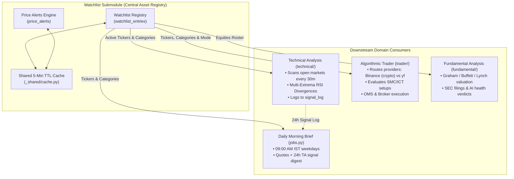
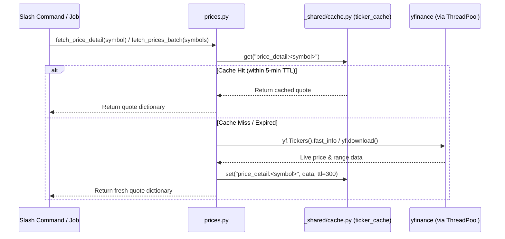

# Watchlist Submodule (`finance/watchlist/`)

> 📚 **Navigation:**
> - [Finance Domain Root](../README_finance.md)
> - [Technical Analysis Submodule](../technical/README_finance_technical.md)
> - [Fundamental Analysis Submodule](../fundamental/README_finance_fundamental.md)
> - [Algorithmic Trader & OMS](../trader/README_finance_trader.md)
> - [System Architecture](../../SYSTEM_ARCHITECTURE.md)

---

## 1. Overview & Purpose

The **Watchlist Submodule** (`modules/finance/watchlist/`) serves as the central asset registry and real-time price monitoring hub for the entire `finance` domain. All financial submodules—including classical technical analysis, fundamental value screening, and algorithmic trading strategies—discover and track symbols through this module.



### Core Capabilities:
- **Central Ticker Registry**: Manages tracked assets across global equities, benchmarks, cryptocurrencies, foreign exchange pairs, and commodities.
- **Automatic Category Detection & Alias Normalization**: Infers asset categories based on naming conventions while accepting user inputs without underscores (mitigating Telegram markdown formatting issues).
- **Parallel Batch Pricing**: Concurrently retrieves market prices, 24-hour deltas, and 52-week ranges via `yfinance` with thread-pool optimization (`run_in_executor`).
- **In-Memory & Persistent Caching**: Shared 5-minute TTL caching layer (`_shared/cache.py`) prevents redundant HTTP requests and API rate-limiting.
- **Bi-Directional Stateful Price Alerts**: Monitors user-defined upper and lower price thresholds, as well as high-water peak (drawdown) and low-water trough (rally) trailing percentages with automated Telegram alerts.
- **Integrated Morning Market Briefing**: Generates a consolidated 09:00 AM IST daily brief with category-grouped performance and a 24-hour technical alert digest aggregated from `modules.finance.technical.models.SignalLog`.

---

## 2. Submodule Architecture & File Structure

```
automation/app/modules/finance/watchlist/
├── __init__.py      # Submodule registration & APScheduler job binding
├── models.py        # SQLAlchemy database schemas (WatchlistEntry, PriceAlert)
├── prices.py        # Parallel batch quote engine, formatting, 52W metrics & cache bridge
├── commands.py      # Telegram slash command handlers (/watch, /price, /alert, etc.)
└── jobs.py          # Scheduled background routines (price alerts & morning brief)
```

### Component Breakdown

| File | Primary Responsibility |
| :--- | :--- |
| `models.py` | Defines SQLite ORM tables: `watchlist_entries` and `price_alerts`. |
| `prices.py` | Implements `fetch_price_detail()`, `fetch_prices_batch()`, price cards, and category mappings. |
| `commands.py` | Exposes 8 user commands with parameter validation, pre-flight ticker verification, and inline feedback. |
| `jobs.py` | Runs `check_price_alerts_job` (every 5 min) and `daily_summary_job` (09:00 AM IST weekdays). |
| `__init__.py` | Exports the `register()` contract required by `core/registry.py`. |

---

## 3. Database Schema

### 3.1 `WatchlistEntry` (`watchlist_entries`)

Stores the registered ticker roster used across all financial analysis and trading engines.

| Column | Type | Constraints | Description |
| :--- | :--- | :--- | :--- |
| `id` | `INTEGER` | Primary Key, Auto-increment | Unique record identifier. |
| `symbol` | `VARCHAR(30)` | Unique, Indexed, Non-null | Upper-cased asset ticker (e.g. `AAPL`, `^NSEI`, `BTC-USD`). |
| `display_name` | `VARCHAR(200)` | Non-null | Human-readable company or asset name fetched from market metadata. |
| `category` | `VARCHAR(30)` | Indexed, Non-null | Asset category identifier (`us_index`, `indian_index`, `crypto`, etc.). |
| `added_at` | `DATETIME` | Non-null, Default UTC | Timestamp when ticker was added to the watchlist. |

### 3.2 `PriceAlert` (`price_alerts`)

Stores active and triggered price condition rules. Supports both static thresholds and trailing percentage triggers.

| Column | Type | Constraints | Description |
| :--- | :--- | :--- | :--- |
| `id` | `INTEGER` | Primary Key, Auto-increment | Unique alert ID. |
| `symbol` | `VARCHAR(30)` | Indexed, Non-null | Target ticker symbol. |
| `condition` | `VARCHAR(2)` | Nullable | Comparison operator: `>` or `<`. |
| `threshold` | `FLOAT` | Nullable | Target price trigger for static alerts. Set to `0.0` for trailing alerts. |
| `alert_type` | `VARCHAR(20)` | Non-null, Default `'static'` | Alert mode: `'static'` or `'trailing_pct'`. |
| `trail_pct` | `FLOAT` | Nullable | Trailing percentage: negative (e.g. `-5.0` for 5% pullback) or positive (e.g. `+10.0` for 10% rally). |
| `trail_reference_price` | `FLOAT` | Nullable | Dynamic high-water mark peak (for downside trails) or low-water mark trough (for upside trails). Automatically populated with current market price at alert creation. |
| `triggered` | `BOOLEAN` | Default `False`, Indexed | Trigger flag (`True` once fired to prevent repeated alerts). |
| `triggered_at` | `DATETIME` | Nullable | UTC timestamp recorded when the alert fires. |
| `created_at` | `DATETIME` | Non-null, Default UTC | Timestamp when the alert was configured. |

---

## 4. Supported Asset Categories & Detection Rules

The watchlist supports seven asset classes. The detector automatically assigns the category unless explicitly overridden with the `--cat` flag:

| Category ID | Display Label | Detection Heuristics & Suffixes | Examples |
| :--- | :--- | :--- | :--- |
| `us_index` | 🇺🇸 US Indices | Starts with `^` and matches US index symbols (`^GSPC`, `^IXIC`, `^DJI`, etc.) | `^GSPC`, `^IXIC`, `^DJI`, `^RUT` |
| `indian_index` | 🇮🇳 Indian Indices | Starts with `^` and matches Indian benchmarks (`^NSEI`, `^BSESN`, `^CNXIT`) | `^NSEI`, `^BSESN`, `^CNXIT` |
| `indian_stock` | 🇮🇳 Indian Stocks | Ends with `.NS` (NSE) or `.BO` (BSE) | `RELIANCE.NS`, `INFY.NS`, `TCS.NS` |
| `crypto` | 🪙 Crypto | Ends with `-USD`, `-USDT`, or matches known crypto bases | `BTC-USD`, `ETH-USD`, `SOL-USD` |
| `forex` | 💱 Forex | Ends with `=X` currency pair convention | `USDINR=X`, `EURUSD=X`, `GBPUSD=X` |
| `commodity` | 🛢️ Commodities | Ends with `=F` futures convention | `GC=F` (Gold), `SI=F` (Silver), `CL=F` (Crude) |
| `us_stock` | 🇺🇸 US Equities | Default fallback for standard alphanumeric symbols | `AAPL`, `MSFT`, `NVDA`, `TSLA` |

### Category Alias Normalization
Telegram clients frequently strip or misinterpret underscores (`_`) in Markdown text. To prevent user input failures, `_resolve_category()` normalizes raw user inputs against a canonical lookup table (`_CATEGORY_ALIAS`):
- `indianindex` $\rightarrow$ `indian_index`
- `usstock` $\rightarrow$ `us_stock`
- `indianstock` $\rightarrow$ `indian_stock`
- `usindex` $\rightarrow$ `us_index`
- Inputs are case-insensitive (e.g., `CRYPTO`, `Indian_Index`).

---

## 5. Price Quoting & Caching Architecture

To operate efficiently within resource-constrained environments (such as a 1 GB RAM cloud instance) and protect against `yfinance` rate limits, price data retrieval is decoupled into cached helpers in `prices.py`:



### Cache Key Conventions:
- `price_detail:<symbol>`: Stores `{price, change, change_pct, day_high, day_low, week52_high, week52_low}` (5-minute TTL).
- `info:<symbol>`: Stores `{display_name, price}` used for pre-flight validation in `/watch`.

---

## 6. Telegram Slash Command Reference

All commands require user authorization (`authorized_only` security filter configured in `core/bot.py`).

### 6.1 `/watch`
Add one or more tickers to the watchlist. Executes asynchronous pre-flight verification via `yfinance` before committing to the database. Supports partial failure resilience (valid tickers are added even if one symbol fails).
- **Syntax**: `/watch <ticker...> [--cat <category>]`
- **Aliases**: Category aliases supported (e.g. `--cat crypto`, `--cat indian_stock`, `--cat indianstock`).
- **Single Ticker Example**:
  ```
  /watch NVDA
  /watch RELIANCE.NS
  /watch BTC-USD --cat crypto
  ```
- **Bulk Onboarding Example**:
  ```
  /watch NVDA AAPL MSFT AMZN
  /watch RELIANCE.NS, TCS.NS, INFY.NS --cat indian_stock
  ```
- **Feedback**: Displays a detailed single card for individual additions or a consolidated batch summary for bulk submissions.

### 6.2 `/unwatch`
Remove one or more tickers from the watchlist. **Cascades deletion**: automatically deletes all associated static and trailing price alerts from `price_alerts` and reports the count of removed alerts.
- **Syntax**: `/unwatch <ticker...>`
- **Examples**:
  ```
  /unwatch TSLA
  /unwatch TSLA AMD INFY.NS
  ```

### 6.3 `/watchlist`
List all currently tracked tickers grouped by category, with counts and display names.
- **Syntax**: `/watchlist [category]`
- **Examples**:
  ```
  /watchlist
  /watchlist crypto
  ```

### 6.4 `/price`
Display live pricing, 24-hour change, day high/low, and a visual 52-week position range gauge.
- **Syntax**: `/price <ticker>`
- **Example**: `/price AAPL`
- **Output Sample**:
  ```
  📈 AAPL
  💵 224.2300 (+1.45%)
  📊 Day  221.1500 — 225.4000
  📅 52W  `164.08 ──●─────── 237.23 (64%)`
  ```

### 6.5 `/prices`
Concurrently fetches and formats a batch price snapshot across all tickers in the watchlist or a specified category.
- **Syntax**: `/prices [category]`
- **Examples**:
  ```
  /prices
  /prices indian_stock
  ```

### 6.6 `/alert`
Create a price alert. Supports both **static absolute thresholds** and **dynamic trailing percentage pullbacks/rallies**.

#### Static Threshold Alert:
- **Syntax**: `/alert <ticker> <condition> <price>`
- **Condition**: `>` (greater than) or `<` (less than).
- **Examples**:
  ```
  /alert BTC-USD > 95000
  /alert INFY.NS < 1700
  ```

#### Trailing Percentage Alert (Instant Reference Anchoring):
- **Syntax**: `/alert <ticker> trail <pct>%`
- Automatically anchors `trail_reference_price` to the **current market price** immediately upon creation.
- **Downside Trailing (Drawdown from Peak)**: Pass a negative percentage (e.g. `-5%`). Tracks the high-water mark peak and fires when the price drops by $\ge 5\%$ from that peak.
  - **Example**: `/alert AAPL trail -5%`
- **Upside Trailing (Rally from Trough)**: Pass a positive percentage (e.g. `+10%`). Tracks the low-water mark trough and fires when the price rallies by $\ge 10\%$ from that trough.
  - **Example**: `/alert BTC-USD trail +10%`

### 6.7 `/alerts`
List all active, untriggered price alerts with target thresholds and **inline delete buttons** (`[ 🗑 Delete #<id> ]`) for single-tap deletion.
- **Syntax**: `/alerts`

### 6.8 `/delalert`
Delete an active price alert by its unique database ID (manual alternative to inline buttons).
- **Syntax**: `/delalert <id>`
- **Example**: `/delalert 3`

---

## 7. Scheduled Background Jobs

### 7.1 `check_price_alerts_job`
- **Schedule**: Every 5 minutes (`IntervalTrigger(minutes=5)`).
- **Execution Flow**:
  1. Queries all rows in `price_alerts` where `triggered == False` (indexed for efficiency).
  2. Batch-fetches latest market quotes via `fast_info` with 5-minute TTL cache checks.
  3. Evaluates static and trailing conditions.
  4. Commits `triggered = True` and records `triggered_at` UTC timestamp.
  5. **Interactive Alert Notification**: Dispatches Telegram notifications equipped with inline action buttons:
     ```
     [ 📊 Chart ]  [ ⚡ TA ]  [ 🗑 Dismiss ]
     ```
     - **Chart**: Renders and delivers an annotated candlestick chart photo.
     - **TA**: Computes and delivers a full technical analysis summary.
     - **Dismiss**: Removes notification buttons inline.

### 7.2 `daily_summary_job` (Morning Briefing)
- **Schedule**: Mon–Fri at 09:00 AM IST (`CronTrigger(hour=9, minute=0, day_of_week="mon-fri", timezone="Asia/Kolkata")`).
- **Execution Flow**:
  1. Queries all watchlist entries ordered by category.
  2. Batch-fetches latest quotes and 24-hour deltas.
  3. **Cross-Module Signal Integration**: Queries `SignalLog` from `modules.finance.technical.models` (`signal_log` table) for all technical signals logged within the preceding 24 hours (`detected_at >= now - 24h`).
  4. Formats a structured Telegram morning report containing:
     - Grouped price cards with 24h percent changes.
     - A consolidated digest of all recent technical alerts (e.g. RSI boundary crossings, multi-extrema divergences, EMA crossovers, volume spikes).
  5. Dispatches the morning brief to the authorized Telegram chat.

---

## 8. Cross-Submodule Integration Architecture

The Watchlist is the backbone of the `finance` domain:

| Domain Submodule | Integration Pattern & Interaction |
| :--- | :--- |
| **Technical Analysis (`finance/technical`)** | Reads all watchlisted symbols in `scan_signals_job` (every 30m). Respects market hours via `is_market_open(e.category)`. Detected signals are persisted to `signal_log` and fed back into the Watchlist's morning briefing. |
| **Algorithmic Trader (`finance/trader`)** | Queries `watchlist_entries` to determine scan mode (`swing` for indices/crypto vs `intraday` for stocks) and route data providers (`BinanceProvider` for crypto vs `YFinanceProvider` for traditional assets). Evaluates ICT/SMC setups for watchlisted assets. |
| **Fundamental Analysis (`finance/fundamental`)** | Uses watchlist tickers to perform automated value screens (Benjamin Graham, Warren Buffett, Peter Lynch) and generates comprehensive valuation reports. |
| **Operational Health (`ops/health`)** | Probes database connectivity to `watchlist_entries` and evaluates `yfinance` latency and cache health during periodic system checks. |
