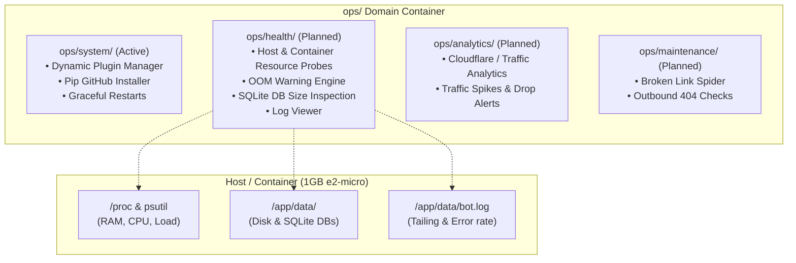

# Domain: `ops/` — Operational Controls & Site Reliability

The `ops` domain manages the administrative lifecycle, operational tooling, and platform health for the automation engine running on the GCP `e2-micro` instance.

---

## 1. Domain Architecture



---

## 2. Active Submodules

### `ops/system/` — Agentic Plugin Package Manager
- **File**: [`system/__init__.py`](system/__init__.py)
- **Security**: Bound to `authorized` Telegram administrator filter.
- **Commands**:
  - `/system install <domain>` — Installs an extension package from GitHub (`bash07/automation-<domain>`), persists to `/app/domain_modules.txt`, and triggers a graceful container restart.
  - `/system remove <domain>` — Uninstalls the package via `pip` and cleans persistence.
  - `/system list` — Lists currently active installed dynamic modules.
  - `/system restart` — Restarts the container process (Docker daemon revives within ~3s).

---

## 3. Planned Implementation: `ops/health/` — System Resource & Host Health

### 3.1 Background & Motivation
The automation bot operates on a **1 GB GCP `e2-micro` instance** running Debian with Docker.
* **OOM Kill Risk**: Standard Linux kernels abruptly terminate (`SIGKILL`) Python processes when memory is exhausted without swap leeway.
* **Disk Contention**: The persistent volume `/app/data/` houses `automation.db`, `cache.db` (persistent L2 disk cache), and log files. Without tracking, write-ahead logs or uncompressed logs can fill the volume.
* **Silent Stalls**: High CPU spikes or runaway threads in background tasks can starve the Telegram polling loop.

### 3.2 Key Capabilities

#### A. Host & Container Metrics (`/sys` or `/health`)
* **Memory & RAM**:
  * Total, Used, Available RAM.
  * Container cgroup memory vs. host memory.
  * Buffer/cache usage.
* **CPU & System Load**:
  * 1m, 5m, 15m load averages.
  * Current process CPU utilization.
* **Storage & Databases**:
  * Mount point `/app/data` disk usage (`total`, `used`, `free`, `used_pct`).
  * `automation.db` size + WAL file size (`automation.db-wal`).
  * `cache.db` size.
* **Runtime Vitality**:
  * Python process RSS memory.
  * Active thread count & open file descriptor (FD) count.

#### B. Proactive Resource Alerts (APScheduler Job)
* **Frequency**: Runs every 15 minutes (`check_system_health_job`).
* **Thresholds**:
  * **Memory Critical**: Available RAM $< 150\text{ MB}$ $\rightarrow$ Dispatches `CRITICAL` Telegram alert with top memory consumers.
  * **Disk Critical**: Disk utilization $> 85\%$ or free space $< 1.5\text{ GB}$ $\rightarrow$ Dispatches `WARNING` alert.
  * **DB Bloat Warning**: SQLite DB + WAL $> 500\text{ MB}$ $\rightarrow$ Prompts manual or automated vacuum/checkpointing.

#### C. Remote Log Inspection (`/logs`)
* **Commands**:
  - `/logs` — Return the last 25 lines of application logs.
  - `/logs <n>` — Return the last $n$ lines (capped at 100).
  - `/logs errors` — Return the last 20 warning/error records.

### 3.3 Proposed Data Model & Architecture

```
ops/
├── __init__.py
├── README_ops.md               <-- This documentation & roadmap
├── system/
│   └── __init__.py             <-- Active package manager
└── health/                     <-- Target submodule
    ├── __init__.py             <-- Module registration & telegram router
    ├── probes.py               <-- Pure reading from psutil / /proc (memory, cpu, disk)
    ├── jobs.py                 <-- 15-minute APScheduler watchdog
    ├── formatters.py           <-- Markdown system card formatting
    └── logs.py                 <-- Tail reader for bot.log
```

### 3.4 Target Telegram Output Mockup (`/sys`)

```text
🖥️ System Health — e2-micro (1 GB)
━━━━━━━━━━━━━━━━━━━━
🧠 Memory (RAM):
  • Used: 412 MB / 980 MB (42%)
  • Available: 568 MB 🟢
  • Bot Process RSS: 142 MB

⚡ CPU & Load:
  • Load Avg: 0.18, 0.22, 0.15
  • Bot CPU: 2.1%

💾 Disk & Storage (/app/data):
  • Free: 14.2 GB / 20.0 GB (71% free) 🟢
  • automation.db: 4.8 MB (WAL: 128 KB)
  • cache.db: 12.1 MB

🧵 Engine Vitality:
  • Python Threads: 8
  • Bot Uptime: 4d 12h 31m
```

---

## 4. Implementation Steps When Ready
1. Add `psutil` or native `/proc` readers into `ops/health/probes.py`.
2. Implement `/sys` command handler and markdown formatting in `ops/health/formatters.py`.
3. Add `check_system_health_job` to APScheduler running every 15 minutes with Telegram threshold alerts.
4. Add `/logs [n]` command with safe pagination and error filtering.
5. Register `ops/health` within `ops/__init__.py`.
6. Add unit tests in `tests/ops/test_health.py` validating probe parsing and threshold alerting.
